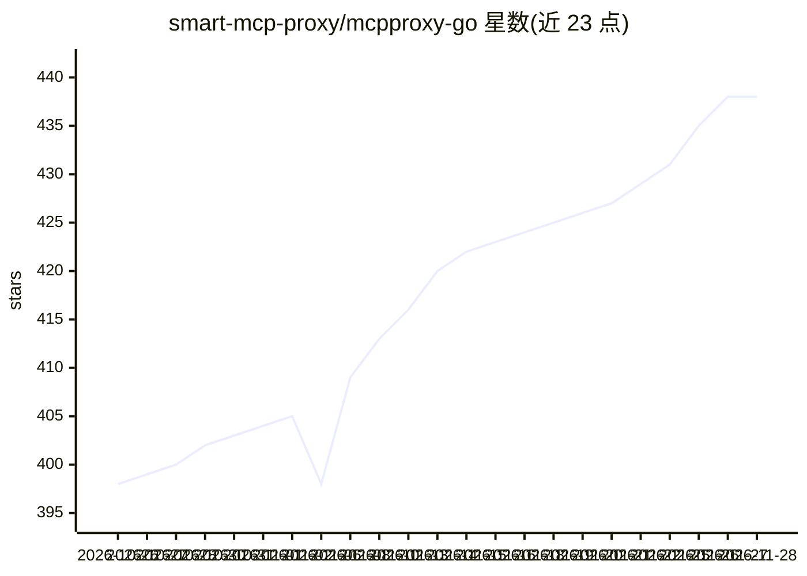

# smart-mcp-proxy/mcpproxy-go

⭐ 438 · Go · MIT · 推送 2026-11-27 · [GitHub](https://github.com/smart-mcp-proxy/mcpproxy-go) · [官网](https://mcpproxy.app) · 组织维护

**给 AI Agent 前置的 MCP 服务器安全代理与工具发现网关**

以单一二进制提供的 MCP 代理网关：将数百个上游 MCP 服务器聚合为一个端点，agent 只看到少量检索与调用工具（retrieve_tools/describe_tool/call_tool_* 变体），通过 BM25 按需检索工具并按需加载 schema，以减少上下文占用。新服务器进入隔离区，需人工审核批准后工具才对 agent 可见；调用按 read/write/destructive 意图变体校验，全部调用写入本地 Activity Log。支持可插拔 Docker 安全扫描器（Snyk/Semgrep/Trivy 等，输出 SARIF）。提供 web UI 与 macOS 菜单栏应用，README 同时给出令牌节省的实测口径与不适用范围。

## 筛选速览

| 维度 | 判定 | 备注 |
|---|---|---|
| AI 角色 | `ai-ecosystem` | LLM/agent 周边工具 |
| 许可风险 | `permissive` | MIT |
| 部署形态 | `desktop` | 安装包/桌面程序 |
| 模型依赖 | — | README 未给出锁定关系 |
| 硬件要求 | — | 无带数字的原话,不猜 |
| 安装摩擦 | `low` | 无编译、无系统依赖或容器化 |
| 成熟度 | — | 结构信号不足 |

## 能力要点

- BM25 工具检索与按需 schema 加载，减少 agent 上下文占用
- 新服务器隔离审核机制与工具定义变更复查（manual/scan/auto 信任模式）
- read/write/destructive 意图校验与本地 Activity Log 审计
- 可插拔 Docker 安全扫描器，结果归一为 SARIF

## 适用场景

- 接入大量 MCP 服务器时绕过 IDE 的工具数量上限
- 控制 agent 上下文中工具定义占用的 token
- 新接入的 MCP 服务器先隔离审核再放行
- 为 cron/CI 无人值守任务预检工具可用性

## 场景标签

 · 领域:AI Agent 基础设施/MCP 网关

## 证据(README 行号)

> L2:  MCPProxy — Supercharge AI Agents, Safely · One safe endpoint in front of every MCP server
> L29: - **Scale beyond API limits** – Federate hundreds of MCP servers while bypassing Cursor's 40-tool limit and OpenAI'

## 星数曲线

2026-10-26 398 → 2026-11-28 438（+40）

---
*卡片 v1 · prompt 1.4 · 生成 2026-11-25 · 置信度 high · 依据 README sha `c7bc86266a01` · [字段定义](../../DATASET.md)*
