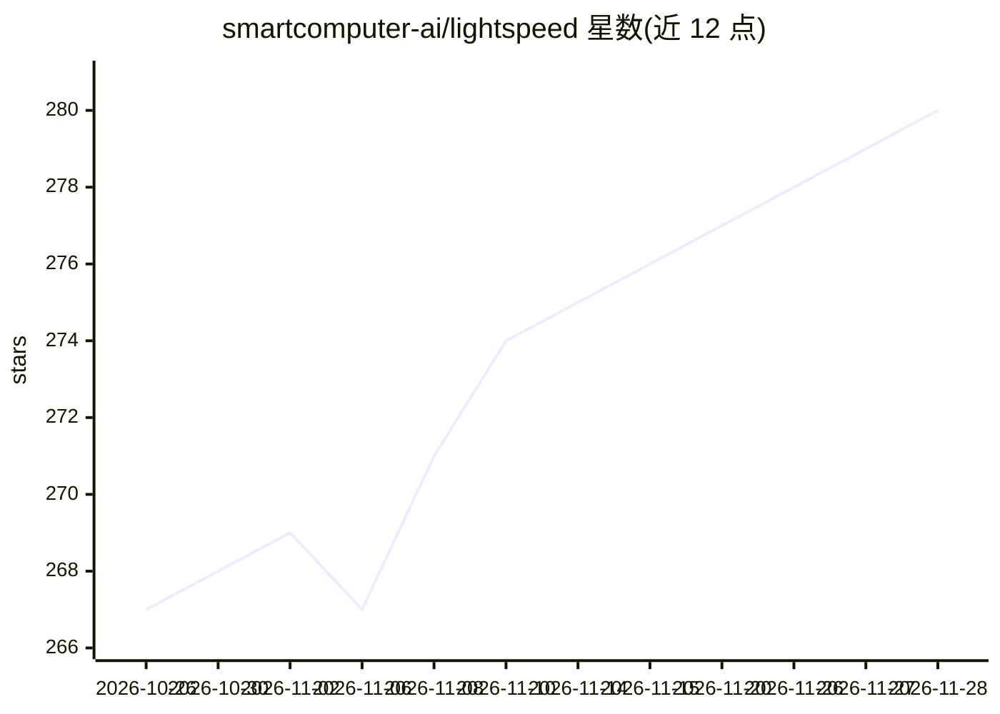

# smartcomputer-ai/lightspeed

⭐ 280 · Rust · Apache-2.0 · 推送 2026-11-26 · [GitHub](https://github.com/smartcomputer-ai/lightspeed) · [官网](https://ls.bot/) · 组织维护

**在 Temporal 上以持久工作流运行大规模托管 agent 集群的基础设施**

以 Rust 编写、运行于 Temporal 的开源 agent 基础设施：将 agent 循环、上下文与会话状态实现为事件溯源的确定性持久工作流，数据存于 Postgres（可选 S3），shell 与文件系统按需挂到临时借用的 VM/沙箱，单个 worker 可承载多个 agent，会话可在重启后存活并运行数周至数月。前端为 TypeScript/React，提供模型接入、MCP、子 agent、定时 Bot、多租户与 RBAC 等能力，含 web/CLI 启动脚本与文档站。

## 筛选速览

| 维度 | 判定 | 备注 |
|---|---|---|
| AI 角色 | `ai-ecosystem` | LLM/agent 周边工具 |
| 许可风险 | `permissive` | Apache-2.0 |
| 部署形态 | `None` |  |
| 模型依赖 | local-ok | 支持本地模型 |
| 硬件要求 | — | 无带数字的原话,不猜 |
| 安装摩擦 | `low` | 无编译、无系统依赖或容器化 |
| 成熟度 | `idea` | |

## 能力要点

- 事件溯源确定性内核：重放会话日志并发出 effect intents，内核不做 I/O
- harness 与计算分离：一台 worker 管理多个 agent，环境按需挂载并随空闲策略暂停/停止
- 支持 OpenAI/Anthropic 及 OpenAI 兼容端点（OpenRouter、DeepSeek、vLLM、Ollama）
- Bot 联邦、触发器、子 agent 委派与会话 fork/clone 原语

## 适用场景

- 为数千用户提供无需常驻 VM 的个人助理服务
- 协调多个 agent 长期构建、测试、评审代码的软件工厂
- 值班运维 agent：调查告警、提出修复并通过聊天回报
- 长时间运行的科研实验 agent：按需启动计算并监督进度

## 场景标签

`AI 助手` `科研工具` `Agent 框架` · 领域:Agent 开发

## 证据(README 行号)

> L13: Lightspeed is open-source infrastructure for running managed agent fleets as durable workflows.
> L23: Lightspeed's Rust core runs on Temporal today and stores
> L36: So, in Lightspeed, the harness (the agent loop, context, and session state) runs as a lightweight

## 星数曲线

2026-10-26 267 → 2026-11-28 280（+13）

---
*卡片 v1 · prompt 1.4 · 生成 2026-11-25 · 置信度 high · 依据 README sha `e9b3db2bd164` · [字段定义](../../DATASET.md)*
