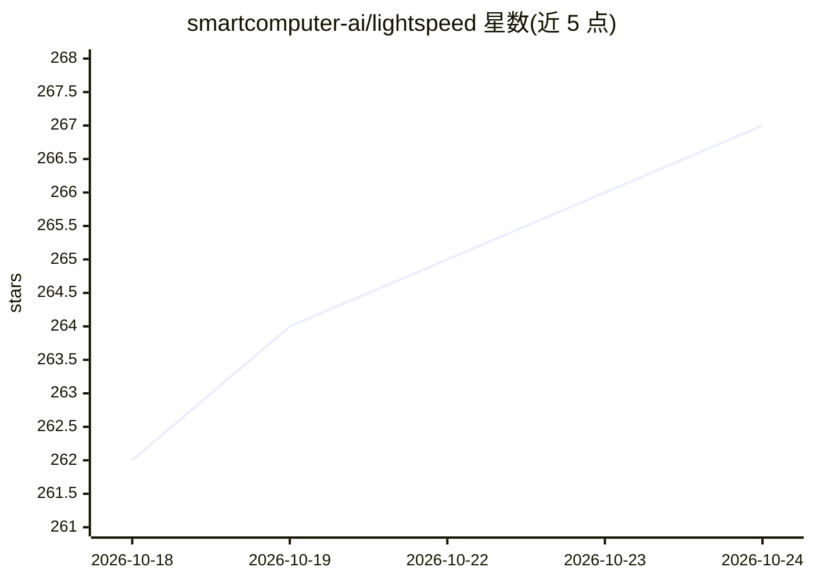

# smartcomputer-ai/lightspeed

⭐ 267 · Rust · Apache-2.0 · 推送 2026-10-20 · [GitHub](https://github.com/smartcomputer-ai/lightspeed) · [官网](https://ls.bot/) · 组织维护

**Rust 编写的托管 agent 舰队基础设施，基于 Temporal 持久工作流**

开源基础设施项目：将 agent 循环、上下文与会话状态作为 Temporal 上的持久工作流运行，agent 可跨重启存活数周至数月；Shell、代码执行与文件系统在需要时才挂载 VM 或沙箱，单 worker 可管理数百 agent。核心为事件溯源、确定性设计且自身不做 I/O，数据存于 Postgres（可选 S3），前端 TypeScript/React。支持 OpenAI/Anthropic 及 OpenAI 兼容后端（OpenRouter/DeepSeek/vLLM/Ollama），提供子 agent、MCP、bot 联邦、多租户与角色权限。从源码运行需 Rust 工具链、Node.js 24+、Docker Compose 与 protoc，通过 ./dev.sh 启动。

## 筛选速览

| 维度 | 判定 | 备注 |
|---|---|---|
| AI 角色 | `ai-ecosystem` | LLM/agent 周边工具 |
| 许可风险 | `permissive` | Apache-2.0 |
| 部署形态 | `None` |  |
| 模型依赖 | local-ok | 支持本地模型 |
| 硬件要求 | — | 无带数字的原话,不猜 |
| 安装摩擦 | `low` | 无编译、无系统依赖或容器化 |
| 成熟度 | — | 结构信号不足 |

## 能力要点

- harness 与计算分离：单 worker 管理数百持久 agent，按需挂载 VM/沙箱
- 事件溯源的确定性核心，自身不做 I/O，大载荷存入 CAS
- 支持 OpenAI/Anthropic 及 OpenAI 兼容后端（OpenRouter/DeepSeek/vLLM/Ollama）
- 子 agent、MCP、bot 联邦、多租户与基于角色的权限

## 适用场景

- 为大量用户运行个人助手而不为每人保留空闲 VM
- 构建长时间自治的软件工厂（多 agent 协作开发与测试）
- 值班运维 agent 调查告警并通过 Telegram/WhatsApp 汇报
- 长期运行的实验型研究 agent 按需拉起计算并监督进度

## 场景标签

`多智能体` `Agent 框架` · 领域:Agent 开发

## 证据(README 行号)

> L13: Lightspeed is open-source infrastructure for running managed agent fleets as durable workflows.
> L36: So, in Lightspeed, the harness (the agent loop, context, and session state) runs as a lightweight
> L149: In Lightspeed, every agent is driven by an event-sourced, deterministic core. The runtime replays the session log,

## 星数曲线

2026-10-18 262 → 2026-10-24 267（+5）

---
*卡片 v1 · prompt 1.4 · 生成 2026-10-22 · 置信度 high · 依据 README sha `9e9ad1111dac` · [字段定义](../../DATASET.md)*
