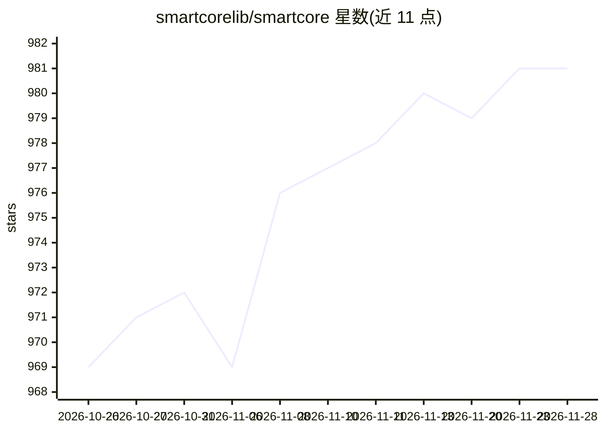

# smartcorelib/smartcore

⭐ 981 · Rust · Apache-2.0 · 推送 2026-11-23 · [GitHub](https://github.com/smartcorelib/smartcore) · [官网](https://smartcorelib.github.io) · 组织维护

**Rust 机器学习与数值计算库：覆盖经典监督/无监督算法**

面向 Rust 开发者的机器学习与数值计算库，覆盖线性模型、决策树与集成方法、SVM、KNN、朴素贝叶斯、聚类、矩阵分解、预处理与模型选择等经典算法，内置 CSV 读取、数据集生成器与样本数据集。通过 Cargo.toml 引入，采用 trait 抽象的线性代数层，默认针对 WASM/WASI 构建，serde 与 datasets 为可选 feature；0.7.0 存在破坏性变更并移除部分绑定（如 nalgebra-bindings），MSRV 为 1.85。

## 筛选速览

| 维度 | 判定 | 备注 |
|---|---|---|
| AI 角色 | `ai-native` | 本体是模型或模型工具 |
| 许可风险 | `permissive` | Apache-2.0 |
| 部署形态 | `None` |  |
| 模型依赖 | — | README 未给出锁定关系 |
| 硬件要求 | — | 无带数字的原话,不猜 |
| 安装摩擦 | `low` | 无编译、无系统依赖或容器化 |
| 成熟度 | — | 结构信号不足 |

## 能力要点

- 覆盖分类、回归、聚类、矩阵分解等经典算法模块
- 可选 ndarray 绑定与 lazy-normalization 特性
- WASM/WASI 优先的默认构建，支持浏览器与嵌入式部署
- 内置 CSV 读取、数据集生成器与 digits/diabetes 等样本数据集

## 适用场景

- 在 Rust 项目中训练和使用经典机器学习模型
- 将机器学习模型编译到 WASM 目标部署
- 通过 Jupyter（EVCXR）笔记本交互式学习该库 API

## 场景标签

 · 领域:机器学习/科学计算库

## 证据(README 行号)

> L7:  Machine Learning in Rust
> L13: smartcore is a fast, ergonomic machine learning library for Rust, covering classical supervised and unsupervised me
> L17: - Broad algorithm coverage: linear models, tree-based methods, ensembles, SVMs, neighbors, clustering, decompositio

## 星数曲线

2026-10-26 969 → 2026-11-28 981（+12）

---
*卡片 v1 · prompt 1.4 · 生成 2026-11-25 · 置信度 high · 依据 README sha `a32033ed242b` · [字段定义](../../DATASET.md)*
