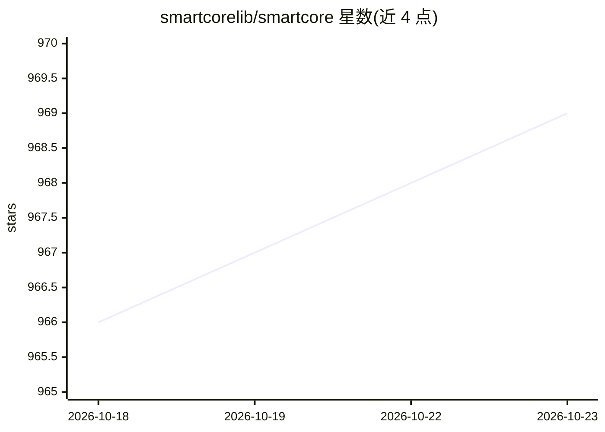

# smartcorelib/smartcore

⭐ 969 · Rust · Apache-2.0 · 推送 2026-10-22 · [GitHub](https://github.com/smartcorelib/smartcore) · [官网](https://smartcorelib.github.io) · 组织维护

**面向 Rust 的经典机器学习算法库，覆盖分类/聚类/回归**

用 Rust 编写的机器学习库，提供线性模型、树与集成方法、SVM、KNN、朴素贝叶斯、聚类、矩阵分解与预处理等经典监督/无监督算法，并通过模块化线性代数 trait 与可选 ndarray 集成抽象底层。默认特性面向 WASM/WASI 移植性，serde 与数据集为可选 feature。附带 CSV 读取器、数据集生成器、内置样本数据集、K-fold 与参数搜索等工具。通过 Cargo.toml 依赖安装，MSRV 1.85（Rust 2024 edition）。面向开发与科研用户。

## 筛选速览

| 维度 | 判定 | 备注 |
|---|---|---|
| AI 角色 | `ai-native` | 本体是模型或模型工具 |
| 许可风险 | `permissive` | Apache-2.0 |
| 部署形态 | `None` |  |
| 模型依赖 | — | README 未给出锁定关系 |
| 硬件要求 | — | 无带数字的原话,不猜 |
| 安装摩擦 | `low` | 无编译、无系统依赖或容器化 |
| 成熟度 | — | 结构信号不足 |

## 能力要点

- 覆盖线性模型、树/森林、SVM、KNN、朴素贝叶斯、聚类、矩阵分解等算法
- 模块化线性代数 trait 与可选 ndarray 集成
- WASM/WASI 优先的默认特性，可移植到浏览器与嵌入式
- 内置 CSV 读取器、数据集生成器与样本数据集（feature 门控）

## 适用场景

- 在 Rust 项目中使用经典机器学习算法构建模型
- 在浏览器（WASM）或嵌入式环境运行机器学习推理
- 实验与教学中快速用生成数据集和内置数据集验证算法

## 场景标签

 · 领域:机器学习/科学计算

## 证据(README 行号)

> L7:  Machine Learning in Rust
> L13: smartcore is a fast, ergonomic machine learning library for Rust, covering classical supervised and unsupervised me
> L17: - Broad algorithm coverage: linear models, tree-based methods, ensembles, SVMs, neighbors, clustering, decompositio

## 星数曲线

2026-10-18 966 → 2026-10-23 969（+3）

---
*卡片 v1 · prompt 1.4 · 生成 2026-10-21 · 置信度 high · 依据 README sha `c46d99cf78cd` · [字段定义](../../DATASET.md)*
