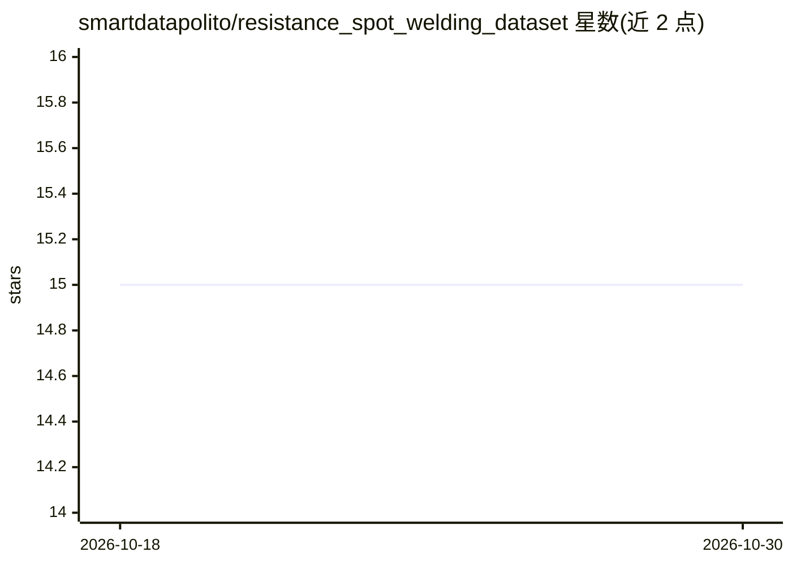

# smartdatapolito/resistance_spot_welding_dataset

⭐ 15 · NOASSERTION · 推送 2026-10-04 · [GitHub](https://github.com/smartdatapolito/resistance_spot_welding_dataset) · 组织维护

**电阻点焊故障检测数据集：1,976 条带标签工业时序数据**

面向电阻点焊故障预测研究的标注数据集，数据来自某汽车企业产线。含 1,976 个焊点样本，覆盖 28 个车身、158 个焊接点；每个样本提供电压、电流、压力三条时序曲线（归一化到 [0,1]、零填充至 1,000 时间步）及二值标签（79 条故障、1,897 条正常），并附焊接日期（2023/06–2024/03）。配套论文《Fault Prediction in Resistance Spot Welding》比较多种机器学习方法。仅以 CSV 文件形式发布，需引用论文。

## 筛选速览

| 维度 | 判定 | 备注 |
|---|---|---|
| AI 角色 | `ai-knowledge` | 知识聚合/清单类 |
| 许可风险 | `none` | NOASSERTION |
| 部署形态 | `None` |  |
| 模型依赖 | — | README 未给出锁定关系 |
| 硬件要求 | — | 无带数字的原话,不猜 |
| 安装摩擦 | `low` | 无编译、无系统依赖或容器化 |
| 成熟度 | — | 结构信号不足 |

## 能力要点

- 1,976 个样本、二值故障标签（79 故障/1,897 正常）
- 电压/电流/压力三条归一化时序，零填充至 1,000 步
- 覆盖 28 个车身、158 个焊接点，含焊接日期字段

## 适用场景

- 工业时序故障预测方法的训练与评测
- 机器学习方法在制造质检场景的对比研究
- 不平衡二分类基准实验

## 场景标签

 · 领域:工业制造/机器学习数据集

## 证据(README 行号)

> L2: This repository contains a real-world dataset collected from a leading automotive company, focused on the resistance
> L31: @article{ciravegna2024fault,

## 星数曲线

2026-10-18 15 → 2026-10-30 15（+0）

---
*卡片 v1 · prompt 1.4 · 生成 2026-10-30 · 置信度 high · 依据 README sha `1ff3de091ace` · [字段定义](../../DATASET.md)*
