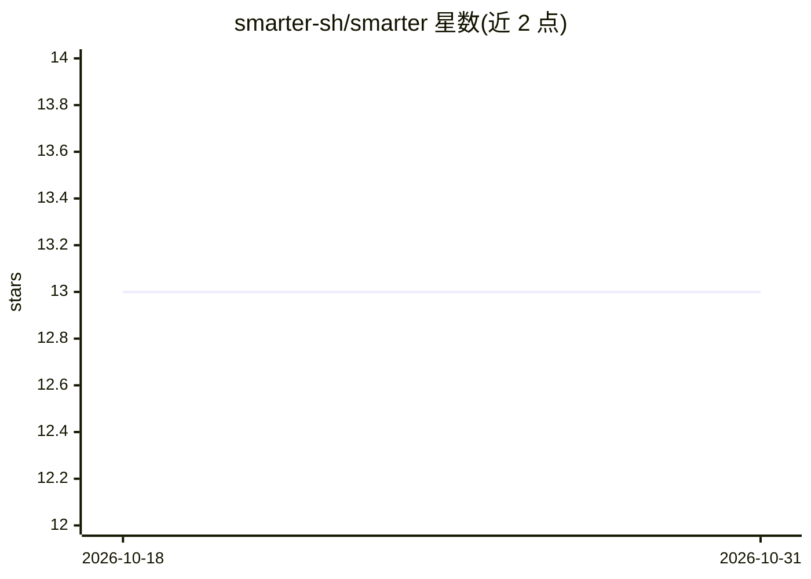

# smarter-sh/smarter

⭐ 13 · Python · AGPL-3.0 · 推送 2026-10-30 · [GitHub](https://github.com/smarter-sh/smarter) · [官网](https://smarter.sh/) · 组织维护

**YAML 声明式构建 AI 应用与资源管理的云原生平台**

开源云原生平台与开发框架，用类似 Kubernetes 的声明式 YAML Manifest（SAM）定义 AI 应用：接入远端 API、SQL、MCP 服务器、Web 搜索与自有文档，无需编写 Python。代理服务器提供对 AI 提供商的受控访问，输入输出 Guardrails 做审查与审计，LLMClient/Orchestrator 组合多模型与多 agent 工作流。面向提示工程团队与企业，支持 OpenAI、Google AI、Meta AI、DeepSeek 及自托管模型；提供 Web 控制台、REST API、CLI、Python SDK 与 React 聊天组件。基于 Django/DRF/Pydantic 构建，单容器起跑，可经 Helm 部署到 Kubernetes。

## 筛选速览

| 维度 | 判定 | 备注 |
|---|---|---|
| AI 角色 | `ai-ecosystem` | LLM/agent 周边工具 |
| 许可风险 | `viral` | AGPL-3.0 |
| 部署形态 | `self-host` | docker 或自建部署 |
| 模型依赖 | — | README 未给出锁定关系 |
| 硬件要求 | — | 无带数字的原话,不猜 |
| 安装摩擦 | `low` | 无编译、无系统依赖或容器化 |
| 成熟度 | — | 结构信号不足 |

## 能力要点

- YAML Manifest 一条命令部署 AI 应用，无需写 Python
- Guardrails 审查每条进出消息并记录干预（提示注入/越狱/泄密等）
- LLMClient/Orchestrator 组合多提供商模型与多 agent 工作流
- 多提供商支持：OpenAI、Google AI、Meta AI、DeepSeek 及 LLMHost 自托管

## 适用场景

- 我用 YAML 声明并部署一个能查数据库、调 API、用 MCP 工具的 AI 应用
- 企业内提示工程团队在统一平台上设计、测试、部署与治理 AI 资源
- 在自有基础设施（Docker/Kubernetes）上运行带审计与成本核算的多租户 AI 平台

## 场景标签

`Agent 框架` `模型网关` `多智能体` · 领域:Agent 开发

## 证据(README 行号)

> L36: - **No code. Just a manifest.** A Smarter Manifest (SAM)
> L78:  - A proxy server that gives secure, governed, auditable access to AI

## 星数曲线

2026-10-18 13 → 2026-10-31 13（+0）

---
*卡片 v1 · prompt 1.4 · 生成 2026-10-31 · 置信度 mid · 依据 README sha `aff8d58c2a99` · [字段定义](../../DATASET.md)*
