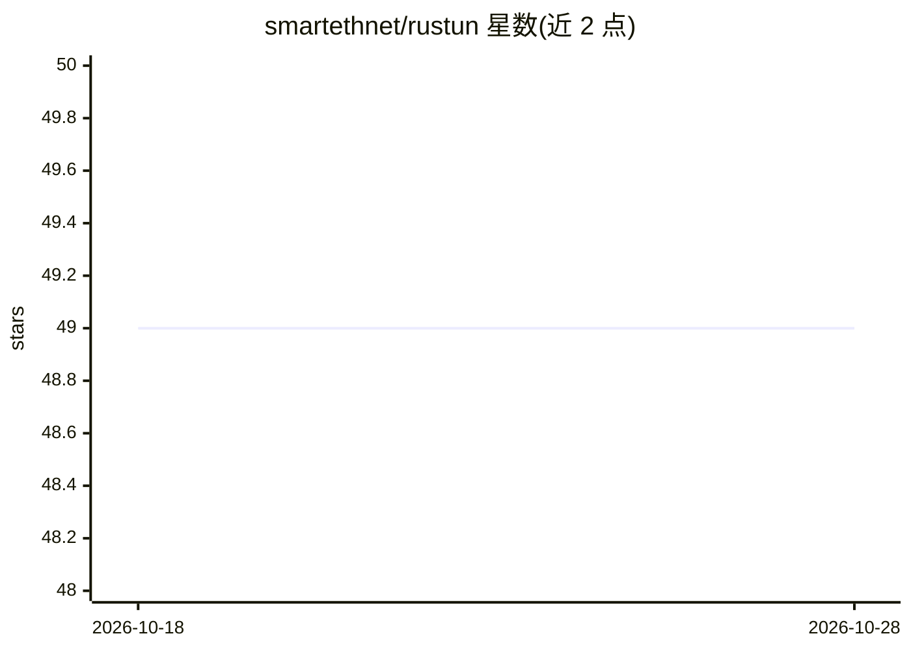

# smartethnet/rustun

⭐ 49 · Rust · 推送 2026-05-01 · [GitHub](https://github.com/smartethnet/rustun) · [官网](https://smartethnet.github.io) · 组织维护 · 中文 README

**Rust 编写的 AI 驱动 VPN 隧道：智能选路 P2P 组网**

用 Rust 编写的跨平台 VPN 隧道，主打 AI 驱动的自动路径选择：IPv6 直连 → STUN 打洞 → 中继回退，无需手动配置。支持多租户集群隔离、ChaCha20-Poly1305/AES-256-GCM/XOR 加密、CIDR 子网映射（仅 Linux）与动态路由更新。服务端提供一键安装脚本，客户端为二进制程序，另有 Web 管理面板与 iOS/macOS TestFlight 移动端。README 自述为 Beta 实验性项目，生产环境需自担风险。

## 筛选速览

| 维度 | 判定 | 备注 |
|---|---|---|
| AI 角色 | `ai-enhanced` | 去掉 AI 部分产品仍成立 |
| 许可风险 | `permissive` | — |
| 部署形态 | `None` |  |
| 模型依赖 | — | README 未给出锁定关系 |
| 硬件要求 | — | 无带数字的原话,不猜 |
| 安装摩擦 | `low` | 无编译、无系统依赖或容器化 |
| 成熟度 | `idea` | |

## 能力要点

- 自动路径选择：IPv6 直连、STUN 打洞、中继回退
- ChaCha20-Poly1305（默认）/AES-256-GCM/XOR 加密
- 多租户集群隔离与动态路由更新（无需重启）
- 跨平台客户端与 Web 管理面板

## 适用场景

- 在 NAT 环境下自动打通 P2P 隧道组网
- 团队或多环境隔离管理 VPN 隧道
- Linux 下解决重叠子网的 CIDR 映射

## 场景标签

 · 领域:网络/VPN 基础设施

## 证据(README 行号)

> L22: An AI-driven VPN tunnel written in Rust with automatic path selection: IPv6 direct → STUN hole punching → relay fal
> L3:  AI-Driven Intelligent VPN Tunnel

## 星数曲线

2026-10-18 49 → 2026-10-28 49（+0）

---
*卡片 v1 · prompt 1.4 · 生成 2026-10-24 · 置信度 mid · 依据 README sha `056da23c5d4f` · [字段定义](../../DATASET.md)*
