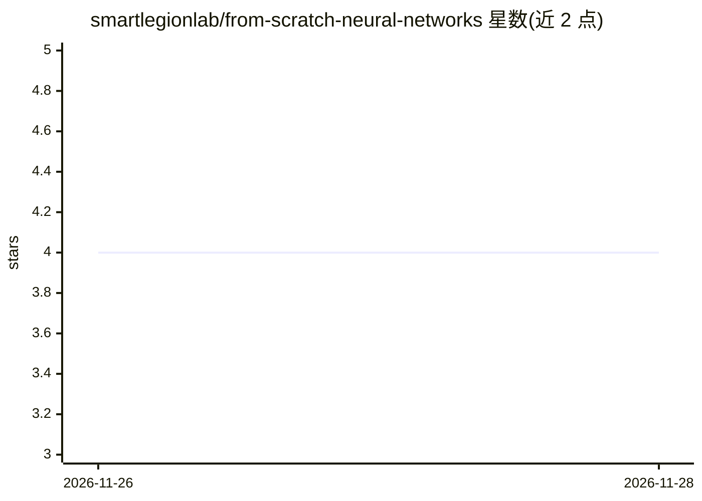

# smartlegionlab/from-scratch-neural-networks

⭐ 4 · HTML · BSD-3-Clause · 推送 2026-11-27 · [GitHub](https://github.com/smartlegionlab/from-scratch-neural-networks) · [官网](https://smartlegionlab.github.io/interactive.html) · 组织维护

**浏览器内从零实现的 MLP 教学演示集（4 个单文件应用）**

四个独立 HTML 单文件应用，用纯 JavaScript 手写完整训练流程：前向传播、反向传播、mini-batch SGD（Boolean 应用还提供 Adam）。应用覆盖逻辑门、手写数字识别、X/O 形状识别、俄/英文姓名性别分类，训练全程在浏览器客户端完成，无需服务器、构建步骤或网络连接。带实时可视化（激活亮度、权重符号与幅度、损失曲线、决策图）与 JSON 权重导出/导入。定位为教学演示，数据集多为内置或用户现场绘制。

## 筛选速览

| 维度 | 判定 | 备注 |
|---|---|---|
| AI 角色 | `ai-native` | 本体是模型或模型工具 |
| 许可风险 | `permissive` | BSD-3-Clause |
| 部署形态 | `None` |  |
| 模型依赖 | — | README 未给出锁定关系 |
| 硬件要求 | — | 无带数字的原话,不猜 |
| 安装摩擦 | `low` | 无编译、无系统依赖或容器化 |
| 成熟度 | — | 结构信号不足 |

## 能力要点

- 纯 JavaScript 从零实现 MLP，无框架与运行时依赖
- 单 HTML 文件，浏览器直接运行，100% 客户端
- 实时可视化：激活、权重、损失曲线与决策边界
- 训练权重 JSON 导出/导入，可保存与复用

## 适用场景

- 直观理解反向传播与梯度下降的训练过程
- 在浏览器中体验手写数字/形状识别的完整训练流程
- 演示为什么单层感知器无法学习 XOR
- 导出训练好的权重文件分享给他人复用

## 场景标签

`教程课程` · 领域:学习与行业

## 证据(README 行号)

> L18: A collection of real multilayer perceptrons (MLPs) implemented **from scratch in pure JavaScript**. No frameworks, 
> L22: This repository contains four independent, ready-to-run applications. Each one implements a complete training pipel
> L24: The apps are designed as an educational demonstration: they show, in real time, how a small network reorganizes its

## 星数曲线

2026-11-26 4 → 2026-11-28 4（+0）

---
*卡片 v1 · prompt 1.4 · 生成 2026-11-26 · 置信度 high · 依据 README sha `225ebdba3dad` · [字段定义](../../DATASET.md)*
