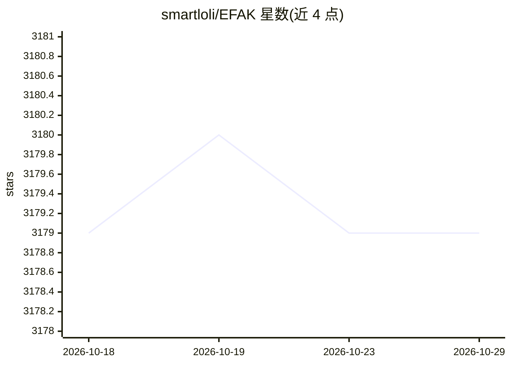

# smartloli/EFAK

⭐ 3,179 · Java · 推送 2026-09-12 · [GitHub](https://github.com/smartloli/EFAK) · [官网](https://www.kafka-eagle.org/) · 个人维护 · 中文 README

**面向 Kafka 运维的开源监控平台，内置多模型 AI 助手**

基于 Spring Boot 3.4.5 与 JDK 17 的 Kafka 集群监控与管理系统：监控 Broker、主题分区、消费者组与吞吐等指标，支持多集群、基于 Redis 的分布式任务调度、多渠道告警与聚合降噪。AI 部分：集成 OpenAI、Claude、DeepSeek 等大语言模型提供对话式运维助手，支持 Function Calling 查询实时数据、自动生成图表与 SSE 流式响应。部署方式为 Docker 一键部署或 tar.gz 安装包，需 MySQL 与 Redis。

## 筛选速览

| 维度 | 判定 | 备注 |
|---|---|---|
| AI 角色 | `ai-enhanced` | 去掉 AI 部分产品仍成立 |
| 许可风险 | `none` | — |
| 部署形态 | `self-host` | docker 或自建部署 |
| 模型依赖 | locked-api |  |
| 硬件要求 | — | 无带数字的原话,不猜 |
| 安装摩擦 | `low` | 无编译、无系统依赖或容器化 |
| 成熟度 | — | 结构信号不足 |

## 能力要点

- 实时监控 Broker/主题分区/消费者组，支持多集群管理
- AI 助手集成多种大语言模型，Function Calling 查询实时数据并自动生成图表
- 基于 Redis 的分布式任务分片、故障转移与负载均衡
- 邮件、钉钉、企业微信多渠道告警与动态阈值

## 适用场景

- 集中监控和管理多个 Kafka 集群的健康状态与性能指标
- 通过对话向 AI 助手询问集群性能并获取分析建议
- 配置多渠道告警规则，接收消费延迟等异常通知

## 场景标签

 · 领域:大数据中间件运维/监控

## 证据(README 行号)

> L10: **EFAK-AI (Eagle For Apache Kafka - AI)** 是一款开源的 Kafka 智能监控与管理平台，融合了人工智能技术，为 Kafka 运维提供智能化、可视化、自动化的全方位解决方案。
> L14: - **🧠 AI 驱动**: 集成主流大语言模型（OpenAI、Claude、DeepSeek 等），提供智能对话式运维
> L22: - **多模型支持**: 集成 OpenAI、Claude、DeepSeek 等多种大语言模型

## 星数曲线

2026-10-18 3,179 → 2026-10-29 3,179（+0）

---
*卡片 v1 · prompt 1.4 · 生成 2026-10-21 · 置信度 high · 依据 README sha `f919f4dd6b42` · [字段定义](../../DATASET.md)*
