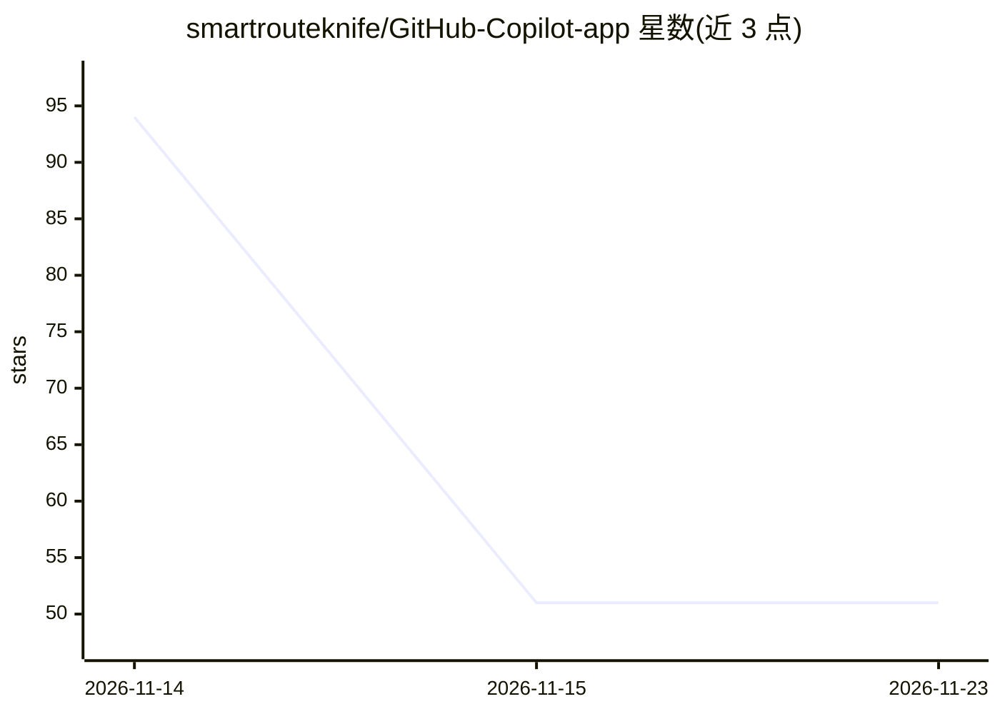

# smartrouteknife/GitHub-Copilot-app

⭐ 51 · Apache-2.0 · 推送 2026-11-15 · [GitHub](https://github.com/smartrouteknife/GitHub-Copilot-app) · 组织维护

**管理 GitHub 仓库软件工作的 Copilot 桌面应用**

GitHub, Inc. 发布的桌面应用，面向使用 GitHub Copilot 的开发者，用于在 GitHub 仓库中查找、运行、引导和完成软件工作。本地会话在独立 git worktree 中运行，云会话运行在 GitHub 托管的隔离环境中。提供 Canvas 查看与编辑 agent 工作、My Work 汇总会话/issue/PR、Automations 调度重复任务、Agent Merge 推进 PR 审查与合并。需要 Git 与任意 Copilot 订阅，或自带模型 key（BYOK）。通过 Releases 页面下载安装包，仓库闭源（All rights reserved）并声明收集使用数据与对话数据。

## 筛选速览

| 维度 | 判定 | 备注 |
|---|---|---|
| AI 角色 | `ai-native` | 本体是模型或模型工具 |
| 许可风险 | `permissive` | Apache-2.0 |
| 部署形态 | `desktop` | 安装包/桌面程序 |
| 模型依赖 | — | README 未给出锁定关系 |
| 硬件要求 | — | 无带数字的原话,不猜 |
| 安装摩擦 | `low` | 无编译、无系统依赖或容器化 |
| 成熟度 | — | 结构信号不足 |

## 能力要点

- 本地会话各自运行在隔离 git worktree，云会话在 GitHub 托管环境运行
- Canvas 将计划、终端、diff、工作流状态呈现为可检查的共享界面
- Automations 将重复提示与工作流转为定时/后台任务
- 无 Copilot 订阅时可通过 BYOK 接入自己的模型提供方

## 适用场景

- 并行运行多个 agent 处理 bug 调查、issue 实现与审查反馈
- 在单一控制中心管理会话、issue 与 PR，决定下一步工作
- 让 agent 推进 PR 通过审查、检查与合并条件

## 场景标签

`编码 Agent` `工作流自动化` · 领域:效率与自动化

## 证据(README 行号)

> L3: The GitHub Copilot app is an agent-native desktop experience for finding, running, steering, and landing software wo
> L13: The GitHub Copilot app is an agent-native desktop experience for managing software work from idea to pull request. 
> L26: - A GitHub Copilot plan — any plan works, including Copilot Free and GitHub Copilot Student. No Copilot plan? You c

## 星数曲线

2026-11-14 94 → 2026-11-23 51（-43）

---
*卡片 v1 · prompt 1.4 · 生成 2026-11-18 · 置信度 high · 依据 README sha `b87d21cbdb86` · [字段定义](../../DATASET.md)*
