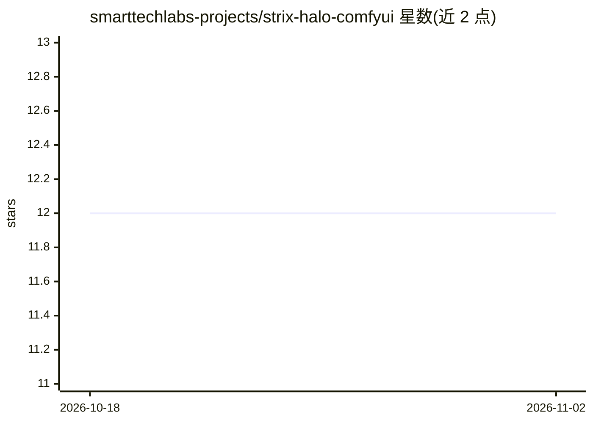

# smarttechlabs-projects/strix-halo-comfyui

⭐ 12 · Shell · 推送 2025-12-14 · [GitHub](https://github.com/smarttechlabs-projects/strix-halo-comfyui) · [官网](https://www.smarttechlabs.de) · 组织维护

**AMD Ryzen AI Max 395 上 GPU 加速运行 ComfyUI 的安装脚本与文档**

面向 AMD Strix Halo（gfx1151）APU 用户的 ComfyUI 部署工具：提供 shell 安装脚本，安装 scottt 的自包含 gfx1151 PyTorch wheel（要求 Python 3.11），绕过官方 ROCm wheel 不含 gfx1151 内核及 CloudFront nightly wheel 缺 hipsparselt 的问题；脚本克隆官方 ComfyUI、创建虚拟环境、以 --no-deps 策略安装依赖防止 CUDA torch 覆盖，并生成启动脚本设置 HIP 相关环境变量。在 GMKtec EVO-2 上测试，附大量故障排查文档。限制：仅限 Ubuntu 22.04/24.04 等 Linux、需自装 ROCm、RAM 32GB+ 推荐。

## 筛选速览

| 维度 | 判定 | 备注 |
|---|---|---|
| AI 角色 | `ai-ecosystem` | LLM/agent 周边工具 |
| 许可风险 | `none` | — |
| 部署形态 | `desktop` | 安装包/桌面程序 |
| 模型依赖 | — | README 未给出锁定关系 |
| 硬件要求 | — | 无带数字的原话,不猜 |
| 安装摩擦 | `high` | 编译与系统依赖俱全 |
| 成熟度 | — | 结构信号不足 |

## 能力要点

- 安装脚本自动处理 Python 3.11 校验、ROCm 验证、GPU 可见性检测
- 采用 scottt 自包含 gfx1151 wheel，内置全部所需 ROCm 库
- --no-deps 策略与最终强制重装防止依赖覆盖正确 torch 版本
- 生成启动脚本设置 HIP_VISIBLE_DEVICES 等环境变量并 unset CUDA_VISIBLE_DEVICES

## 适用场景

- 在 Ryzen AI Max 395 迷你主机上跑 ComfyUI 做 GPU 加速生图
- 解决官方 ROCm wheel 在 gfx1151 上的 invalid device function 等报错
- 按文档排查 No HIP GPUs / torch 版本错误等常见问题

## 场景标签

`图像生成` · 领域:内容生成

## 证据(README 行号)

> L1: # ComfyUI Installer for AMD Ryzen AI Max 395 (gfx1151)
> L3: This repository contains installation scripts and documentation for running **ComfyUI** with GPU acceleration on AMD

## 星数曲线

2026-10-18 12 → 2026-11-02 12（+0）

---
*卡片 v1 · prompt 1.4 · 生成 2026-11-01 · 置信度 mid · 依据 README sha `b91160f7ed5e` · [字段定义](../../DATASET.md)*
