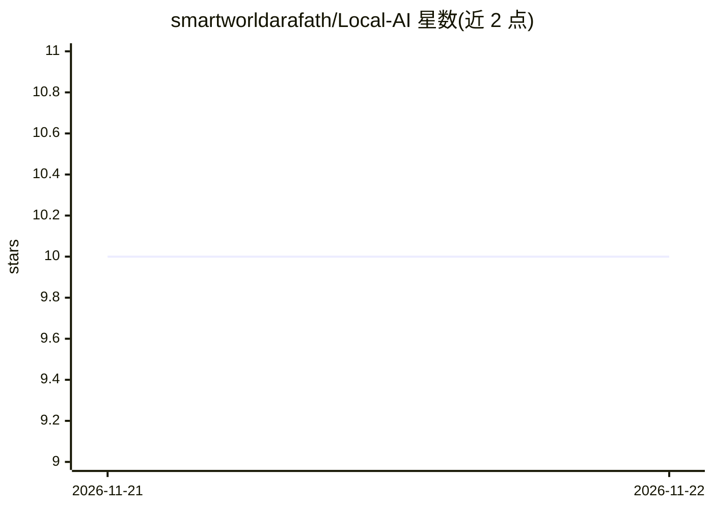

# smartworldarafath/Local-AI

⭐ 10 · Kotlin · AGPL-3.0 · 推送 2026-11-15 · [GitHub](https://github.com/smartworldarafath/Local-AI) · [官网](https://github.com/smartworldarafath/Local-AI/releases) · 个人维护

**Android 端本地优先 AI 助手：多模型接入+本地 RAG 记忆+工具调用**

面向 Android 用户的开源本地 AI 助手应用，以 Kotlin/Jetpack Compose（Material 3 Expressive）构建。核心机制：多 provider 模型路由（62 个预设+自定义 OpenAI 兼容端点）、设备端向量记忆（RAG，余弦相似度检索）、内置工具调用循环（最多 256 步）、PRoot Linux 沙箱执行 Python/Shell、MCP 客户端（SSE/Streamable-HTTP），并内嵌 Ktor Web 服务器供局域网浏览器访问。数据、密钥、嵌入均存于设备本地，无遥测。提供通用 APK 下载或从源码构建（需 JDK 17、Android SDK、Node.js、NDK/CMake）。

## 筛选速览

| 维度 | 判定 | 备注 |
|---|---|---|
| AI 角色 | `ai-native` | 本体是模型或模型工具 |
| 许可风险 | `viral` | AGPL-3.0 |
| 部署形态 | `desktop` | 安装包/桌面程序 |
| 模型依赖 | local-ok | 支持本地模型 |
| 硬件要求 | — | 无带数字的原话,不猜 |
| 安装摩擦 | `high` | 编译与系统依赖俱全 |
| 成熟度 | — | 结构信号不足 |

## 能力要点

- 多 provider 路由：62 个预设 + 自定义 OpenAI 兼容端点
- 本地 RAG 记忆：设备端向量嵌入 + SQLite 向量引擎
- PRoot Linux 沙箱运行 Python/Shell（无需 root）
- 内嵌 Web UI：局域网浏览器控制 + mDNS 发现

## 适用场景

- 在手机上与 GPT/Claude/Gemini/本地模型对话且数据不出设备
- 让 AI 通过工具在手机上执行任务（通知、TTS、图像生成、定时消息）
- 手机沙箱内运行 Python 脚本或包管理器
- 从笔记本浏览器通过 Wi-Fi 控制手机上的助手

## 场景标签

`AI 助手` `聊天机器人` `RAG` · 领域:对话与助手

## 证据(README 行号)

> L39: **Local AI** is a state-of-the-art, open-source AI assistant application for Android engineered around **Google's M
> L41: It provides an entirely private, locally sandboxed environment that unites multi-provider LLM routing, local vector
> L64: |**Ask a model to do tasks on my phone**|Built-in tools: `eval_javascript`, `text_to_speech`, `generate_image`, `se

## 星数曲线

2026-11-21 10 → 2026-11-22 10（+0）

---
*卡片 v1 · prompt 1.4 · 生成 2026-11-21 · 置信度 high · 依据 README sha `38de56fb4ebc` · [字段定义](../../DATASET.md)*
