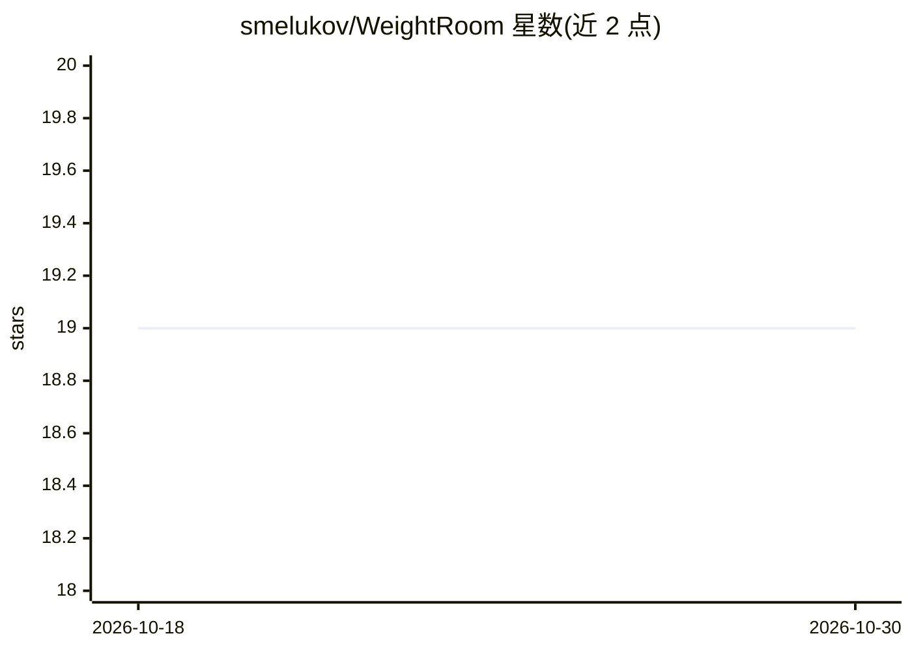

# smelukov/WeightRoom

⭐ 19 · TypeScript · MIT · 推送 2026-08-12 · [GitHub](https://github.com/smelukov/WeightRoom) · [官网](https://smelukov.github.io/WeightRoom/) · 个人维护

**网页版 LLM 硬件计算器：估算本地/云端运行的显存、存储与吞吐**

基于 React/Vite 的网页工具，输入模型架构、量化格式、上下文长度与并发数，输出 RAM（权重+KV 缓存+系统开销）、存储占用与 token 吞吐率估值。支持 4 种 KV 缓存公式（Standard GQA、Sliding Window、MLA、Linear+Full）、MoE 模型、34 个预置模型、粘贴 HuggingFace URL 自动导入 config.json 参数。配置可序列化到 URL 分享，导出 PNG 分享卡、README 徽章与 iframe 嵌件。估算为公式计算，非实测。

## 筛选速览

| 维度 | 判定 | 备注 |
|---|---|---|
| AI 角色 | `ai-ecosystem` | LLM/agent 周边工具 |
| 许可风险 | `permissive` | MIT |
| 部署形态 | `library` | 以包/库形式分发 |
| 模型依赖 | — | README 未给出锁定关系 |
| 硬件要求 | — | 无带数字的原话,不猜 |
| 安装摩擦 | `low` | 无编译、无系统依赖或容器化 |
| 成熟度 | — | 结构信号不足 |

## 能力要点

- RAM/存储/TPS 估算，含 4 种 KV 缓存公式与 MoE 支持
- 粘贴 HuggingFace URL 自动读取 config.json 填充架构参数
- 5 类量化格式（FP/BF16、GGUF、MLX、GPTQ、AWQ）与多推理引擎 KV 预分配策略
- 配置序列化到 URL 分享，可导出徽章、分享图与 iframe 嵌件

## 适用场景

- 买硬件前估算某模型在某量化与上下文下的显存需求
- 对比多个模型/量化配置的内存占用与吞吐
- 在博客或 README 中嵌入模型资源占用的实时计算卡片

## 场景标签

 · 领域:LLM 基础设施/硬件规划

## 证据(README 行号)

> L5: A web calculator that estimates RAM, storage, and token throughput (TPS) for running large language models locally o
> L11: - **RAM estimation** — weights + KV cache + OS overhead, accurate for any context length and batch size

## 星数曲线

2026-10-18 19 → 2026-10-30 19（+0）

---
*卡片 v1 · prompt 1.4 · 生成 2026-10-28 · 置信度 high · 依据 README sha `1e3c9362026a` · [字段定义](../../DATASET.md)*
