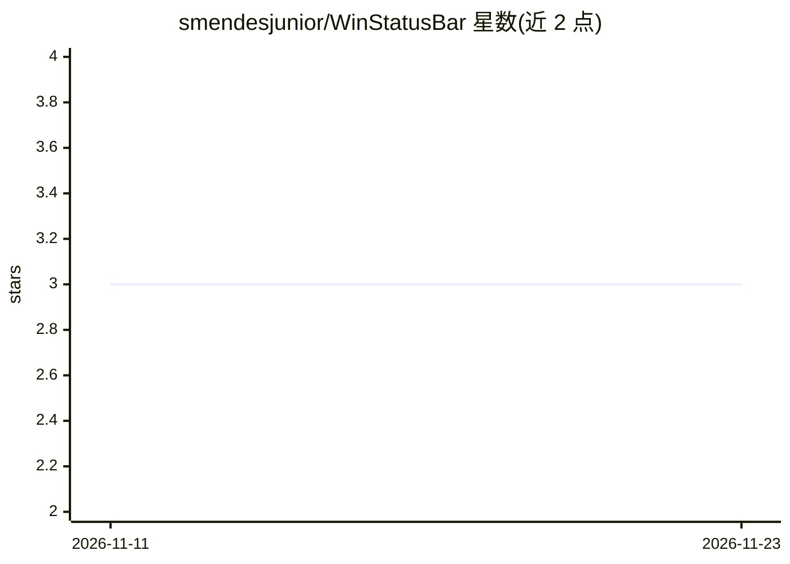

# smendesjunior/WinStatusBar

⭐ 3 · C# · 推送 2026-11-22 · [GitHub](https://github.com/smendesjunior/WinStatusBar) · [官网](https://github.com/smendesjunior/WinStatusBar/releases/latest) · 个人维护

**Windows 11 原生命令栏：一个入口接入多家 AI 与本地模型**

停靠在屏幕顶部的 WinUI 3 命令栏，中央对话框接入 Claude Code、Codex、Gemini、Copilot、Lenovo Qira、Ollama 本地模型或自有 API key，活动窗口自动作为上下文附上。执行器提供带自检的桌面自动化动作（文件、Office COM、应用控制、系统设置），每步验证后执行。通过本地网关把各 AI 接入 Codex 模型选择器并一键同步，同时展示各家配额与 CPU/GPU/网络等硬件面板。winget 或安装包按当前用户安装，无需管理员权限。

## 筛选速览

| 维度 | 判定 | 备注 |
|---|---|---|
| AI 角色 | `ai-ecosystem` | LLM/agent 周边工具 |
| 许可风险 | `none` | — |
| 部署形态 | `desktop` | 安装包/桌面程序 |
| 模型依赖 | local-ok | 支持本地模型 |
| 硬件要求 | — | 无带数字的原话,不猜 |
| 安装摩擦 | `medium` | 含编译或系统依赖之一 |
| 成熟度 | — | 结构信号不足 |

## 能力要点

- 一个输入框接入 Claude Code/Codex/Gemini/Copilot/Qira/Ollama，支持中途切换模型
- 自检式桌面自动化：文件、Office COM、窗口控制、系统设置，逐步验证结果
- 本地网关把全部 AI 注入 Codex 模型选择器，一键同步新 Ollama 模型
- 配额面板（5 小时/周窗口）与 CPU/GPU/RAM/网络实时硬件面板

## 适用场景

- 在不切换窗口的情况下向当前屏幕内容提问
- 用自然语言批量重命名文件、填写 Excel 表格
- 在 Codex 里使用 Claude/Gemini/Copilot 等各家模型
- 集中查看各 AI 订阅的配额使用与 API 开销

## 场景标签

`AI 助手` `GUI 自动化` · 领域:效率与自动化

## 证据(README 行号)

> L4:  A native Windows 11 command bar that talks to Claude, Codex, Gemini, Copilot, Qira and local models,
> L25: |🔌 **Every AI inside Codex**|Claude Code, Google Antigravity, Gemini, Copilot, Lenovo Qira, your API keys and local
> L55: One box at the center of the bar talks to **Claude Code, Codex, Gemini, Google Antigravity, Microsoft Copilot, Leno

## 星数曲线

2026-11-11 3 → 2026-11-23 3（+0）

---
*卡片 v1 · prompt 1.4 · 生成 2026-11-21 · 置信度 high · 依据 README sha `e938cd12492c` · [字段定义](../../DATASET.md)*
