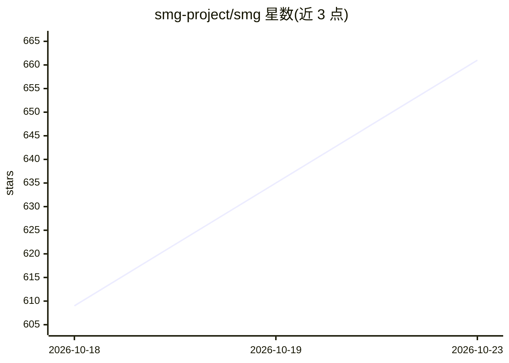

# smg-project/smg

⭐ 661 · Rust · Apache-2.0 · 推送 2026-10-22 · [GitHub](https://github.com/smg-project/smg) · [官网](https://lightseek.org/smg) · 组织维护

**Rust 编写的引擎无关 LLM 网关：统一接入多种推理后端**

Shepherd Model Gateway（SMG）是面向大规模 LLM 部署的模型路由网关：将自托管引擎（vLLM、SGLang、TensorRT-LLM、TokenSpeed、MLX 等）与云厂商（OpenAI、Anthropic、Gemini、xAI、OCI、Bedrock、Azure OpenAI 等）聚合到单一兼容 OpenAI/Anthropic 的端点之后，提供 KV cache 感知路由（radix tree 前缀复用）、10 种路由策略、原生 gRPC 流式管线、多租户与 OIDC 认证、聊天历史存储、MCP 工具执行、WASM 插件与 90+ Prometheus 指标。以 Docker 镜像与 PyPI 包提供，附 CLI 启动命令。

## 筛选速览

| 维度 | 判定 | 备注 |
|---|---|---|
| AI 角色 | `ai-ecosystem` | LLM/agent 周边工具 |
| 许可风险 | `permissive` | Apache-2.0 |
| 部署形态 | `self-host` | docker 或自建部署 |
| 模型依赖 | local-ok | 支持本地模型 |
| 硬件要求 | — | 无带数字的原话,不猜 |
| 安装摩擦 | `low` | 无编译、无系统依赖或容器化 |
| 成熟度 | — | 结构信号不足 |

## 能力要点

- KV cache 感知路由与 10 种路由策略（radix tree 前缀复用）
- 兼容 OpenAI Chat/Responses、Anthropic Messages、Gemini 等多套 API
- 21 种工具调用解析器与 16 种推理解析器，自动模型检测
- 多租户、优先级准入调度、OIDC 认证、WASM 插件与 MCP 集成

## 适用场景

- 将多套自托管推理引擎与云厂商收敛到统一网关做负载均衡
- 在企业内做多租户 LLM 服务治理与可观测性监控
- 在 Kubernetes 集群内做服务发现与多节点高可用部署

## 场景标签

`模型网关` · 领域:Agent 开发

## 证据(README 行号)

> L15: Engine-agnostic, high-performance model-routing gateway for large-scale LLM deployments. SMG centralizes worker lif
> L24: |**🔌 One API, Any Backend**|Route to self-hosted engines over HTTP or gRPC, or to OpenAI, Anthropic, Gemini, and xA

## 星数曲线

2026-10-18 609 → 2026-10-23 661（+52）

---
*卡片 v1 · prompt 1.4 · 生成 2026-10-22 · 置信度 high · 依据 README sha `7f1e820256eb` · [字段定义](../../DATASET.md)*
