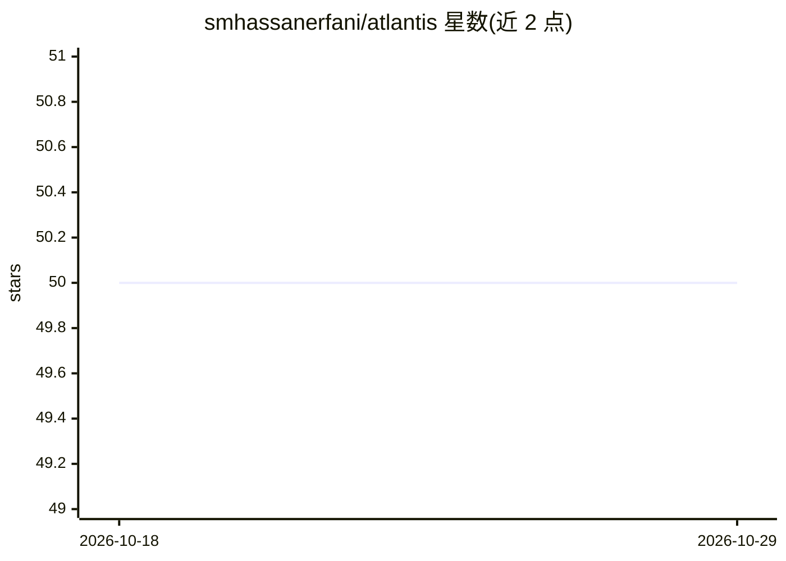

# smhassanerfani/atlantis

⭐ 50 · Python · 推送 2026-07-22 · [GitHub](https://github.com/smhassanerfani/atlantis) · 组织维护

**水体图像语义分割基准数据集（5,195 张，56 类标签）**

南卡罗来纳大学 iWERS 实验室发布的水体图像语义分割基准：5,195 张像素级标注图像，划分 3,364 训练/535 验证/1,296 测试；含 35 类水体（自然与人工）及 21 类通用标签（如 person、car、building）提供上下文信息。图像经 Flickr API 按七种 Creative Commons/美国政府作品许可采集，经两阶段人工筛选后由具水资源工程背景的标注者用 CVAT 标注。同时附带 CNN 分割网络 AQUANet，权重公开于 Google Drive。面向水体分割研究者的基准评测用途。

## 筛选速览

| 维度 | 判定 | 备注 |
|---|---|---|
| AI 角色 | `ai-knowledge` | 知识聚合/清单类 |
| 许可风险 | `none` | — |
| 部署形态 | `None` |  |
| 模型依赖 | — | README 未给出锁定关系 |
| 硬件要求 | — | 无带数字的原话,不猜 |
| 安装摩擦 | `low` | 无编译、无系统依赖或容器化 |
| 成熟度 | — | 结构信号不足 |

## 能力要点

- 5,195 张像素级标注图像，56 类标签（17 人工水体、18 自然水体、21 通用）
- 相似易混类别（如 marsh/swamp、river/canal）通过辅助标签区分的设计
- 附带 AQUANet 双路径 CNN 分割网络及公开训练权重
- 提供 ATLANTIS DEVELOPMENT KIT 供贡献者构建同类数据集

## 适用场景

- 评测语义分割模型在水体场景下的表现
- 研究长尾分布下的水体与水利设施分割
- 复用标注流程开发自己的分割数据集

## 场景标签

`模型评测` `目标检测` · 领域:评测与运维

## 证据(README 行号)

> L2: This is the repository for the ATLANTIS. All waterbody labels are comprehensively described in ATLANTIS Wiki. This d
> L7: ATLANTIS is a benchmark for semantic segmentation of waterbody images. For the first time, this dataset covers a wid
> L52: If you use this data, please cite the following paper which can be downloaded through this link:

## 星数曲线

2026-10-18 50 → 2026-10-29 50（+0）

---
*卡片 v1 · prompt 1.4 · 生成 2026-10-24 · 置信度 high · 依据 README sha `21c5cf0ee5c5` · [字段定义](../../DATASET.md)*
