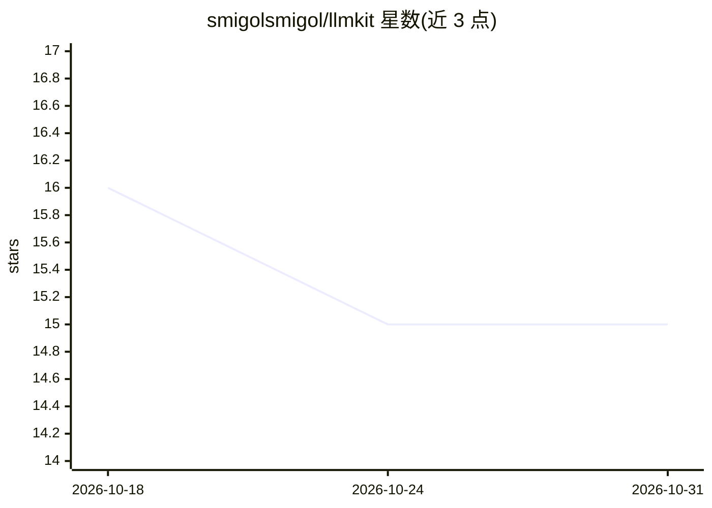

# smigolsmigol/llmkit

⭐ 15 · TypeScript · MIT · 推送 2026-10-30 · [GitHub](https://github.com/smigolsmigol/llmkit) · [官网](https://llmkit.sh) · 个人维护

**面向 AI agent 的成本网关与 SDK 套件：预算准入与费用归因**

开源 AI 网关与多语言 SDK 组合，提供 LLM 成本归因、预算准入控制与请求凭据：网关在向 provider 派发请求前预留预估花费，超出预算的请求被拒绝，响应完成后按实际用量结算；基于 Cloudflare Workers Durable Objects 做原子准入，防止并发请求重复消耗余额。另有不依赖账号的本地跟踪途径：Python transport、零代码 CLI 包装、TypeScript SDK、MCP server 与 Vercel AI SDK provider。限制：网关模式需已有 API key，账号注册暂时不可用；定价目录为固定快照而非实时报价。

## 筛选速览

| 维度 | 判定 | 备注 |
|---|---|---|
| AI 角色 | `ai-ecosystem` | LLM/agent 周边工具 |
| 许可风险 | `permissive` | MIT |
| 部署形态 | `library` | 以包/库形式分发 |
| 模型依赖 | — | README 未给出锁定关系 |
| 硬件要求 | — | 无带数字的原话,不猜 |
| 安装摩擦 | `low` | 无编译、无系统依赖或容器化 |
| 成熟度 | — | 结构信号不足 |

## 能力要点

- 派发前预留预估成本、超预算拒绝、完成后按实际用量结算的预算准入路径
- Durable Object 原子准入 + 派发感知幂等 + 响应字节上限
- 5 个本地 MCP 工具 + 6 个网关工具共 11 个工具
- 本地跟踪途径无需 LLMKit 账号或代理

## 适用场景

- 我在多个 provider 上跑 agent，想统一归因每个请求的成本
- 我要在请求发出前拦截会超出预算的调用
- 我想在 MCP 客户端里查看本地编码会话的花费与预算

## 场景标签

`LLM 可观测性` `模型网关` · 领域:Agent 开发

## 证据(README 行号)

> L14: LLMKit is an open-source AI gateway and SDK suite for cost attribution, budget admission, and
> L26: |CLI wrapper|Your OpenAI or Anthropic client honors its standard base-URL environment variable|`@f3d1/llmkit-cli`|

## 星数曲线

2026-10-18 16 → 2026-10-31 15（-1）

---
*卡片 v1 · prompt 1.4 · 生成 2026-10-30 · 置信度 high · 依据 README sha `f7586a49bcb1` · [字段定义](../../DATASET.md)*
