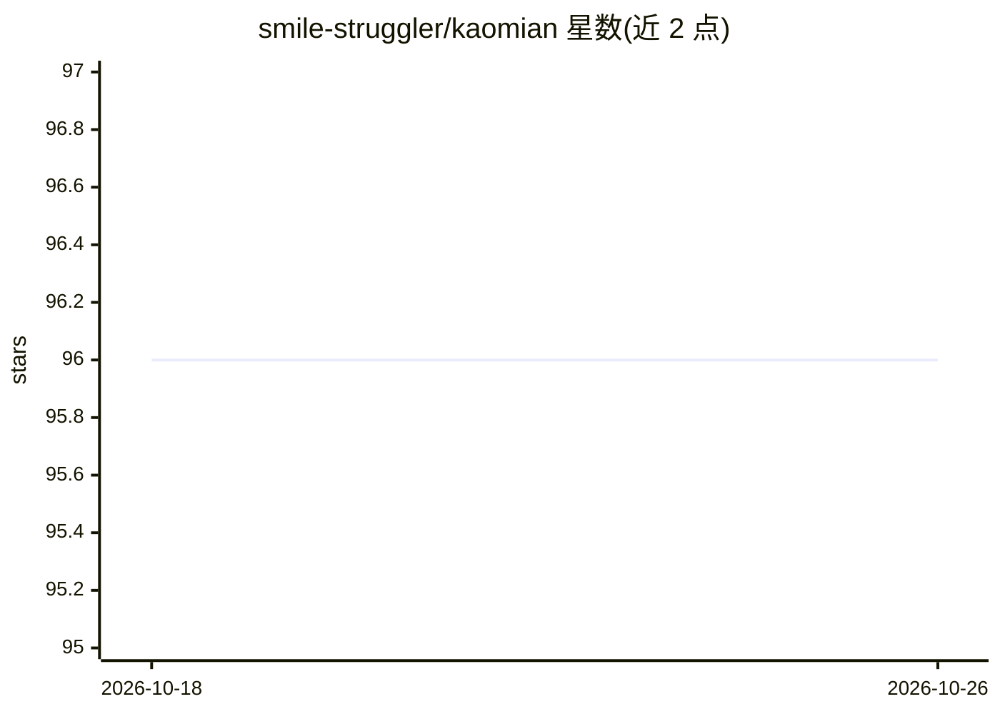

# smile-struggler/kaomian

⭐ 96 · 推送 2026-04-19 · [GitHub](https://github.com/smile-struggler/kaomian) · 个人维护 · 中文 README

**从真实面经帖聚合出的 AI Agent 面试高频题库**

对小红书 AI Agent 面经帖子做抓取、过滤、OCR、结构化抽取与语义归并后生成的结构化题库：覆盖 767 个抓取帖、248 个保留帖、948 道题、638 个 canonical question，按知识问答、Agent/RAG/Tool Calling/Memory、算法手撕等题型组织，每题可追溯到出现帖子、公司与岗位，并统计 Top 100 高频题。数据流水线实际使用 Qwen3-VL-4B/8B 与 Qwen3-Embedding-8B。以 Markdown 文件形式提供，无安装运行流程。

## 筛选速览

| 维度 | 判定 | 备注 |
|---|---|---|
| AI 角色 | `ai-knowledge` | 知识聚合/清单类 |
| 许可风险 | `none` | — |
| 部署形态 | `None` |  |
| 模型依赖 | — | README 未给出锁定关系 |
| 硬件要求 | — | 无带数字的原话,不猜 |
| 安装摩擦 | `low` | 无编译、无系统依赖或容器化 |
| 成熟度 | — | 结构信号不足 |

## 能力要点

- 948 道题经语义归并为 638 个 canonical question
- 抓取→过滤→OCR→抽取→embedding 归并的完整数据流水线
- 每题可追溯到出现的帖子、公司与岗位
- 按 5 种题型与 Top 100 高频题组织索引

## 适用场景

- 准备 AI Agent 岗位面试时按高频题抓重点
- 按题型专项刷题（RAG/Tool Calling/Memory/算法手撕）
- 了解不同公司在 Agent 面试中反复考察的问题

## 场景标签

`精选清单` · 领域:学习与行业

## 证据(README 行号)

> L11: 它是把一批真实 AI Agent 面经帖子做完筛选、OCR、抽取、归并之后，留下来的高频拷打题数据库。
> L92:  先标准化，再做 embedding 召回，再做语义判断，把同义题合并成同一个 canonical question。

## 星数曲线

2026-10-18 96 → 2026-10-26 96（+0）

---
*卡片 v1 · prompt 1.4 · 生成 2026-10-23 · 置信度 high · 依据 README sha `ed8745215d18` · [字段定义](../../DATASET.md)*
