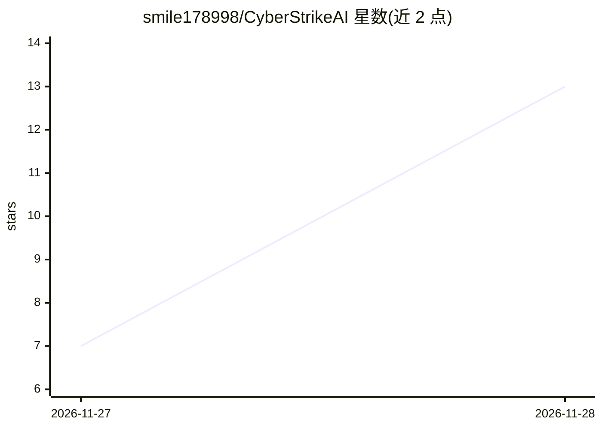

# smile178998/CyberStrikeAI

⭐ 13 · Go · Apache-2.0 · 推送 2026-11-26 · [GitHub](https://github.com/smile178998/CyberStrikeAI) · 个人维护 · 中文 README

**授权安全测试的 AI Agent 工作台：意图转为受控执行**

以 Go 构建的网络安全测试平台，将规划、执行、人工审批、证据留存与回放整合在同一可审计工作区。核心机制包括单 Agent 与 Deep/Plan-Execute/Supervisor 多智能体模式、MCP 协议工具接入（HTTP/stdio/SSE）、100+ YAML 定义的安全工具配方、向量检索知识库、图形化工作流，以及 WebShell 管理与内置 C2 等高危能力（仅限授权目标）。需配置 AI 通道方可使用，带 RBAC、审计日志与 SQLite 持久化，通过 git clone 加 run.sh 一键部署。

## 筛选速览

| 维度 | 判定 | 备注 |
|---|---|---|
| AI 角色 | `ai-native` | 本体是模型或模型工具 |
| 许可风险 | `permissive` | Apache-2.0 |
| 部署形态 | `library` | 以包/库形式分发 |
| 模型依赖 | — | README 未给出锁定关系 |
| 硬件要求 | — | 无带数字的原话,不猜 |
| 安装摩擦 | `low` | 无编译、无系统依赖或容器化 |
| 成熟度 | — | 结构信号不足 |

## 能力要点

- 单 Agent 与 Deep/Plan-Execute/Supervisor 多智能体编排模式
- MCP 集成支持 HTTP、stdito、SSE 与动态工具发现
- 100+ 安全工具 YAML 配方覆盖完整杀伤链
- 人工审批、工具调用拦截与审计日志等治理机制

## 适用场景

- 对自有或授权系统执行自动化渗透测试任务
- 用攻击链建模串联跨会话的资产与漏洞信息
- 通过微信/钉钉/Slack 等聊天机器人接收任务结果
- 团队多角色协作管理漏洞生命周期与资产清单

## 场景标签

`网络安全` `多智能体` `聊天机器人` · 领域:Agent 开发

## 证据(README 行号)

> L9: CyberStrikeAI connects planning, execution, human oversight, evidence, and replay in one auditable workspace. Built 
> L72: - 🤖 **Agentic execution** translates natural-language intent into governed, auditable security actions.
> L79: - 🧰 **Security tools** include 100+ curated YAML recipes with custom extensions and role-scoped access.

## 星数曲线

2026-11-27 7 → 2026-11-28 13（+6）

---
*卡片 v1 · prompt 1.4 · 生成 2026-11-27 · 置信度 high · 依据 README sha `50ddacdee5d8` · [字段定义](../../DATASET.md)*
