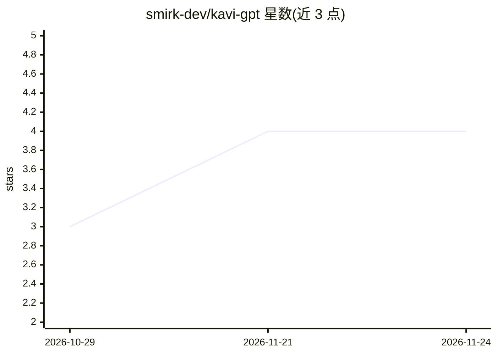

# smirk-dev/kavi-gpt

⭐ — · [GitHub]() · 个人维护

**用纯 NumPy 从零手写 GPT 的教学实现，供学习者研究**

用纯 NumPy 从零实现 GPT 语言模型，前向与反向传播全部手写推导，模型内部不含 autograd、PyTorch 或 TensorFlow。支持 GPT-2 与 Llama 风格（RoPE/RMSNorm/SwiGLU）两种结构切换，提供 byte 级 BPE 分词、KV cache、FlashAttention，梯度经 finite-difference gradcheck 与 PyTorch autograd 对拍双重验证。通过 CuPy 可在 Kaggle 免费 GPU 上训练，在 Shakespeare 语料上生成文本。附 15 章推导书籍、实验日志与评估脚本。主要面向想理解 Transformer 内部机制的学习者。

## 筛选速览

| 维度 | 判定 | 备注 |
|---|---|---|
| AI 角色 | `ai-native` | 本体是模型或模型工具 |
| 许可风险 | `permissive` | — |
| 部署形态 | `library` | 以包/库形式分发 |
| 模型依赖 | — | README 未给出锁定关系 |
| 硬件要求 | — | 无带数字的原话,不猜 |
| 安装摩擦 | `low` | 无编译、无系统依赖或容器化 |
| 成熟度 | — | 结构信号不足 |

## 能力要点

- 全部前向/反向传播以纯 NumPy 手写推导，无 autograd
- 梯度双重验证：float64 有限差分 gradcheck 与 PyTorch autograd 对拍（1e-7）
- 支持 GPT-2 与 Llama 风格块切换，含 KV cache 与 FlashAttention 的 NumPy 实现
- 同一 NumPy 代码经 CuPy 在 Kaggle 免费 GPU 上运行

## 适用场景

- 想逐层理解 GPT 反向传播与 Transformer 结构细节
- 复现消融实验（RoPE/SwiGLU/RMSNorm 等逐项对比）
- 在 Kaggle 免费 GPU 上低成本训练小型语言模型
- 研究 induction heads 等可解释性现象

## 场景标签

`教程课程` · 领域:学习与行业

## 证据(README 行号)

> L3: *Kavi* (कवि) is Sanskrit/Hindi for "poet". It is a GPT language model written from scratch
> L5: and written out, with no autograd, PyTorch or TensorFlow inside the model. It learns to write like
> L110: pip install numpy matplotlib pytest          # torch optional: only for the parity tests

## 星数曲线

2026-10-29 3 → 2026-11-24 4（+1）

---
*卡片 v1 · prompt 1.4 · 生成 2026-11-21 · 置信度 high · 依据 README sha `df470582b2f6` · [字段定义](../../DATASET.md)*
