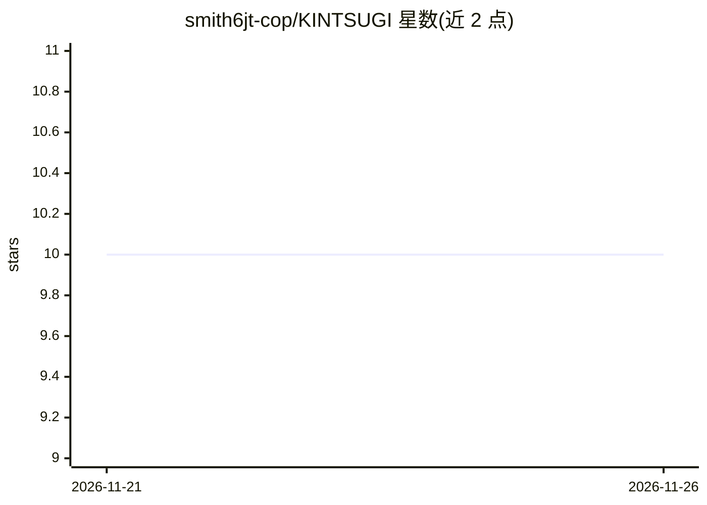

# smith6jt-cop/KINTSUGI

⭐ 10 · Jupyter Notebook · MIT · 推送 2026-10-28 · [GitHub](https://github.com/smith6jt-cop/KINTSUGI) · [官网](https://smith6jt-cop.github.io/KINTSUGI/) · 个人维护

**多重免疫荧光图像处理流水线，可选 MCP 服务器供 AI 助手驱动**

面向具有挑战性的多重免疫荧光数据集的图像处理流水线，覆盖 2D/3D 照明校正（BaSiC）、拼接、去卷积、扩展景深、配准、自发荧光去除、分割、聚类与空间分析，定位为用户参与式而非全自动处理。提供 CLI、Python API、Jupyter notebooks 与 Snakemake 工作流（含 SLURM profile）。可选安装 MCP 服务器（34 个工具、参数学习循环存入 SQLite、路径安全限制、CI 评估门），让任意 MCP 客户端以交互方式驱动信号隔离流程；不安装 MCP 时 CLI/notebooks/工作流可独立运行。支持 NVIDIA 多 GPU 加速，MIT 许可。

## 筛选速览

| 维度 | 判定 | 备注 |
|---|---|---|
| AI 角色 | `ai-enhanced` | 去掉 AI 部分产品仍成立 |
| 许可风险 | `permissive` | MIT |
| 部署形态 | `library` | 以包/库形式分发 |
| 模型依赖 | — | README 未给出锁定关系 |
| 硬件要求 | — | 无带数字的原话,不猜 |
| 安装摩擦 | `medium` | 含编译或系统依赖之一 |
| 成熟度 | — | 结构信号不足 |

## 能力要点

- 可选 MCP 服务器：34 个工具供任意 MCP 客户端驱动图像处理，含参数学习循环
- GPU 加速的照明校正、拼接、去卷积与 EDoF，自动检测所有 NVIDIA GPU
- CLI、Python API、notebooks 与 Snakemake 工作流（SLURM profile）多种使用方式
- MCP 工具 schema 强制校验、项目内路径限制与 CI 评估门

## 适用场景

- 处理光照不均、需要校正与拼接的多重免疫荧光显微数据
- 通过 Claude Code 等 MCP 客户端以对话方式做信号隔离与质控
- 在 HPC 集群用 Snakemake/SLURM 批量运行图像处理工作流
- 跨多个项目目录同步更新 notebooks 与工作流脚本

## 场景标签

`图像视频处理` · 领域:感知与多模态

## 证据(README 行号)

> L3: ## Multiplex image processing for challenging datasets with a focus on user integration rather than automation. This
> L5: **AI-assisted signal isolation:** KINTSUGI ships an optional Model Context Protocol (MCP) server that lets the AI as
> L230: Nothing is configured for any assistant unless you choose it: without `--client` the command asks in a terminal an

## 星数曲线

2026-11-21 10 → 2026-11-26 10（+0）

---
*卡片 v1 · prompt 1.4 · 生成 2026-11-21 · 置信度 high · 依据 README sha `0b1da5555a9f` · [字段定义](../../DATASET.md)*
