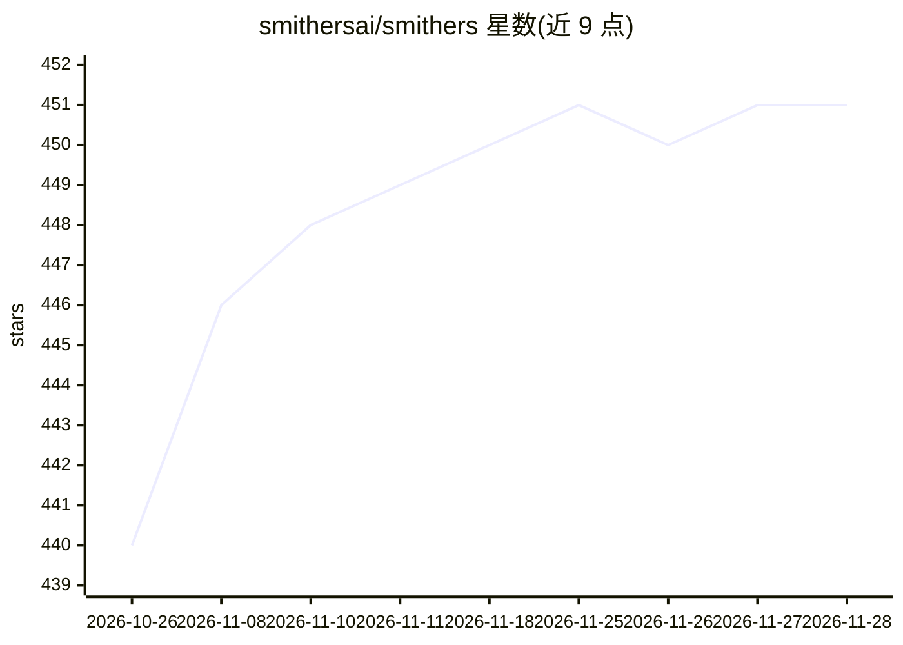

# smithersai/smithers

⭐ 451 · TypeScript · MIT · 推送 2026-11-27 · [GitHub](https://github.com/smithersai/smithers) · [官网](https://smithers.sh) · 组织维护

**面向开发者的 agentic 工作流框架：把 issue 变成可审查的变更**

以 TypeScript 配置文件定义 agentic 工作流的框架，将 issue 转为经测试的代码变更供开发者审查，并可在启用时更新项目 wiki。提供 smithers-ci 通过系统调用级缓存加速既有 GitHub Actions 与本地测试循环，并提供浏览器端仓库浏览应用（查看 diff、运行记录、一键 fork、通过 BYOA MCP 接入外部 agent）。库与 CLI 经 npm 分发，需要 Node.js 22.19 及以上，发布候选在 Linux 上经 Node 26.4.0 认证，MIT 许可。

## 筛选速览

| 维度 | 判定 | 备注 |
|---|---|---|
| AI 角色 | `ai-ecosystem` | LLM/agent 周边工具 |
| 许可风险 | `permissive` | MIT |
| 部署形态 | `library` | 以包/库形式分发 |
| 模型依赖 | — | README 未给出锁定关系 |
| 硬件要求 | — | 无带数字的原话,不猜 |
| 安装摩擦 | `low` | 无编译、无系统依赖或容器化 |
| 成熟度 | — | 结构信号不足 |

## 能力要点

- 用 TypeScript 配置文件定义工作流并持久可靠地执行
- smithers-ci 以 syscall 验证缓存加速 GitHub Actions 与本地测试循环
- 支持 human-in-the-loop：变更生成后由用户审查
- 浏览器端应用支持接入 Claude Code/Codex/Cursor 等 agent（BYOA MCP）

## 适用场景

- 把 GitHub issue 自动转为带测试的代码变更
- 为 agent 的 CI 与本地测试循环加速缓存
- 在浏览器中审查 diff 与 agent 运行记录
- 让 agent 维护项目 wiki 文档

## 场景标签

`编码 Agent` `Agent 框架` `多智能体` · 领域:Agent 开发

## 证据(README 行号)

> L12: Smithers maintains your codebase. It turns issues into tested changes for you to review and, when enabled, keeps th
> L25: Explore files, inspect Uphill continuous metrics, review diffs and runs, fork in one click, or attach your own agen
> L36: The libraries install from npm; start with the

## 星数曲线

2026-10-26 440 → 2026-11-28 451（+11）

---
*卡片 v1 · prompt 1.4 · 生成 2026-11-28 · 置信度 high · 依据 README sha `d5fa569023a4` · [字段定义](../../DATASET.md)*
