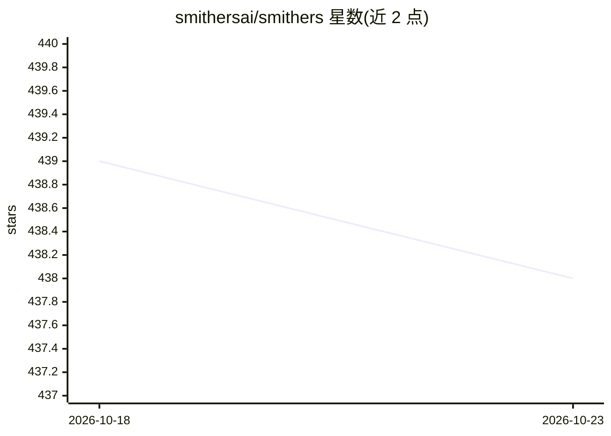

# smithersai/smithers

⭐ 438 · TypeScript · MIT · 推送 2026-10-22 · [GitHub](https://github.com/smithersai/smithers) · [官网](https://smithers.sh) · 组织维护

**用 TypeScript 配置定义并可靠执行代码维护 Agent 工作流的框架**

Smithers 是一个 agentic 工作流框架，面向通过 TypeScript 配置文件定义流程并持久、可靠执行的场景。其应用形态是代码库维护：把 issue 转换为带测试的变更供人审阅，并可选地保持项目 wiki 更新；流程文件与代码同仓存放。提供浏览器中浏览仓库、对话问答与查看运行的入口（需 GitHub 登录），也提供 CLI 与库用于本地执行与编写。运行需 Node.js 22.19 或更高版本，库与 CLI 均从 npm 安装，CLI 通过 smthrs init/flow start 命令启动流程，启动前需为流程 model 字段配置凭证。

## 筛选速览

| 维度 | 判定 | 备注 |
|---|---|---|
| AI 角色 | `ai-ecosystem` | LLM/agent 周边工具 |
| 许可风险 | `permissive` | MIT |
| 部署形态 | `library` | 以包/库形式分发 |
| 模型依赖 | — | README 未给出锁定关系 |
| 硬件要求 | — | 无带数字的原话,不猜 |
| 安装摩擦 | `low` | 无编译、无系统依赖或容器化 |
| 成熟度 | — | 结构信号不足 |

## 能力要点

- 以 TypeScript 配置文件定义 Agent 工作流，支持持久可靠执行
- 将 issue 转为经测试的变更供人审阅，可选维护项目 wiki
- 提供浏览器内对话式操作入口与本地 CLI/库两种使用方式

## 适用场景

- 我希望让 Agent 自动把 issue 变成可审阅的代码变更
- 我需要在代码旁定义流程，让 Agent 持续维护项目与文档
- 我想用 TypeScript 编写和编排多 Agent 后台工作流

## 场景标签

 · 领域:开发工具/Agent 工作流

## 证据(README 行号)

> L12: Smithers maintains your codebase. It turns issues into tested changes for you to review and, when enabled, keeps th
> L29: The libraries install from npm; start with the

## 星数曲线

2026-10-18 439 → 2026-10-23 438（-1）

---
*卡片 v1 · prompt 1.4 · 生成 2026-10-22 · 置信度 high · 依据 README sha `b776df49b64b` · [字段定义](../../DATASET.md)*
