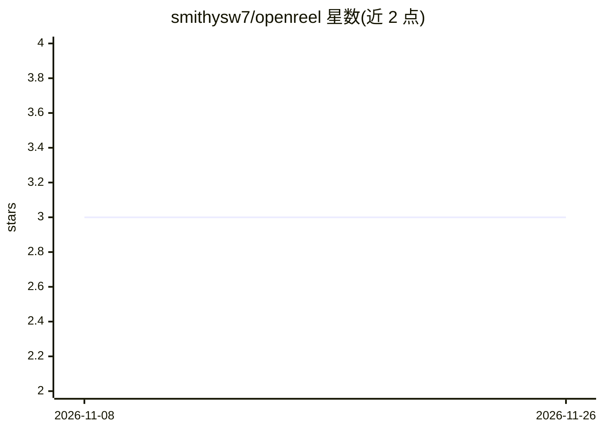

# smithysw7/openreel

⭐ 3 · TypeScript · MIT · 推送 2026-10-25 · [GitHub](https://github.com/smithysw7/openreel) · [官网](https://github.com/smithysw7/openreel/raw/main/demo/openreel-demo.webm) · 个人维护

**本地运行的开源 AI 短片生成工作室，基于 ComfyUI**

OpenReel 是一个开源 AI 短片生成应用：输入一句 logline，生成 8 个镜头的分镜、AI 选角卡、逐镜头视频与最终成片。三层机制保持角色一致性：文本锚定（外观描述注入每个关键帧提示词）、图像锚定（首张头像作为后续生成的参考图/首帧）、风格锁定。支持 local（Z-Image Turbo + MiniMax H3 开放权重，经本地 ComfyUI）、cloud（Comfy Router API）与 mock（ffmpeg 占位）三种后端，解说用 OmniVoice TTS 本地合成。需 Node 22+ 与 ffmpeg，硬件门槛为单张消费级 GPU。

## 筛选速览

| 维度 | 判定 | 备注 |
|---|---|---|
| AI 角色 | `ai-native` | 本体是模型或模型工具 |
| 许可风险 | `permissive` | MIT |
| 部署形态 | `library` | 以包/库形式分发 |
| 模型依赖 | — | README 未给出锁定关系 |
| 硬件要求 | — | 无带数字的原话,不猜 |
| 安装摩擦 | `medium` | 含编译或系统依赖之一 |
| 成熟度 | — | 结构信号不足 |

## 能力要点

- logline 到成片流水线：分镜、AI 选角、镜头生成、自动组装
- 三层角色一致性机制：文本锚定、图像锚定、风格锁定
- local/cloud/mock 三种生成后端，默认本地开放权重零 API 费用
- OmniVoice TTS 本地合成旁白与角色配音

## 适用场景

- 在自己 GPU 上从一句故事梗概生成角色一致的短片
- 参赛 Open Source Higgsfield 类 AI 视频竞赛
- 零配置 demo 模式下无 API key 体验完整产品流程

## 场景标签

`视频生成` `图像生成` `语音合成` · 领域:内容生成

## 证据(README 行号)

> L3: > One logline in, a character-consistent short film out.
> L34: |`local` (default)|Z-Image Turbo|MiniMax H3 (local open weights, native audio)|**$0**|

## 星数曲线

2026-11-08 3 → 2026-11-26 3（+0）

---
*卡片 v1 · prompt 1.4 · 生成 2026-11-26 · 置信度 high · 依据 README sha `667e5398f61f` · [字段定义](../../DATASET.md)*
