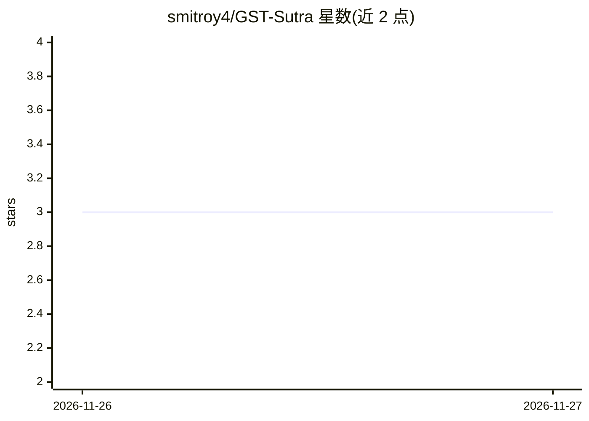

# smitroy4/GST-Sutra

⭐ 3 · JavaScript · 推送 2026-11-20 · [GitHub](https://github.com/smitroy4/GST-Sutra) · [官网](https://gst-sutra.smitroy.com) · 个人维护

**面向印度小商户的 GST 税务问答 RAG 机器人，答案附出处**

基于 Spring Boot 4.1 与 Spring AI 2.0 的 RAG 问答演示应用：知识库为五个 Markdown 格式的官方 GST 文档，先按 800 token 分块并用 NVIDIA 嵌入模型写入 Pinecone，问答时检索相关片段后仅依据上下文作答，每条答案标注来源文件与章节；文档未覆盖时拒绝回答。前端为 React 19 双栏界面（聊天 + Learn GST 学习页），每次回答附免责声明。后端部署于 Oracle Cloud 的 Docker 容器，前端部署在 Vercel。README 声明为非官方演示，不构成税务建议。

## 筛选速览

| 维度 | 判定 | 备注 |
|---|---|---|
| AI 角色 | `ai-native` | 本体是模型或模型工具 |
| 许可风险 | `none` | — |
| 部署形态 | `self-host` | docker 或自建部署 |
| 模型依赖 | — | README 未给出锁定关系 |
| 硬件要求 | — | 无带数字的原话,不猜 |
| 安装摩擦 | `low` | 无编译、无系统依赖或容器化 |
| 成熟度 | — | 结构信号不足 |

## 能力要点

- 仅依据检索到的 Markdown 文档片段作答，无匹配时明确拒答
- 每条答案输出文件与章节来源引用及官方页面链接
- 知识库文档带 front matter 主来源与 last_verified 日期，未核实事实被排除
- 提供 POST /api/chat 与 /api/ingest 接口，模型经 OpenAI 兼容 API 调用

## 适用场景

- 查询包装零食等商品的 GST 税率并看到出处
- 判断营业额是否达到 GST 强制注册门槛
- 查阅税务发票必备字段与申报截止日期

## 场景标签

`聊天机器人` `RAG` `文档问答` · 领域:对话与助手

## 证据(README 行号)

> L11:  A RAG chatbot that answers Indian GST questions for small shop owners, using only official GST documents and showi
> L36: GST Sutra is a focused demonstration of that idea and of building a grounded RAG system with Spring AI. The backend
> L61: A general-purpose model may give outdated or incorrect GST rates. Retrieval-augmented generation limits the model t

## 星数曲线

2026-11-26 3 → 2026-11-27 3（+0）

---
*卡片 v1 · prompt 1.4 · 生成 2026-11-26 · 置信度 high · 依据 README sha `6368bdc99b35` · [字段定义](../../DATASET.md)*
