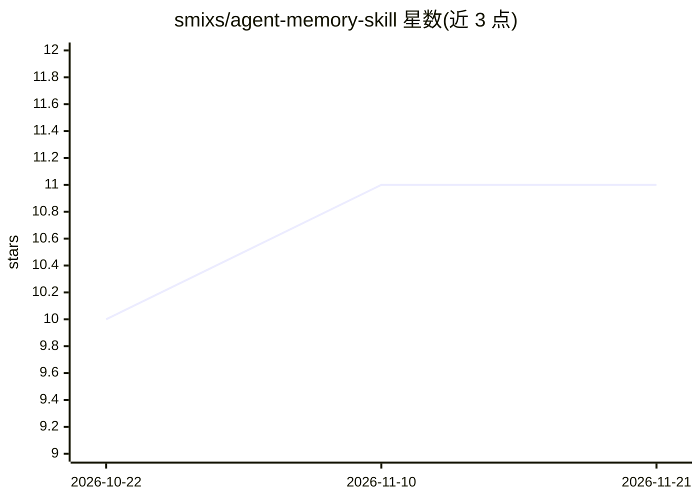

# smixs/agent-memory-skill

⭐ 11 · Python · MIT · 推送 2026-07-21 · [GitHub](https://github.com/smixs/agent-memory-skill) · 个人维护

**给 AI agent 提供基于遗忘曲线的 Markdown 记忆管理脚本**

单文件、零依赖的 Python 记忆引擎，为 AI agent 的会话间记忆设计。以 markdown 文件为存储，按艾宾浩斯遗忘曲线给每张卡片计算 relevance 分数并分为 core/active/warm/cold/archive 五层，随时间衰减、读取时逐层晋升。提供四种检索模式（含随机召回冷层卡片的 creative 模式）以控制 token 成本，通过 YAML frontmatter 与配置文件调参，可作 Claude Code skill 集成，并支持 cron 定时执行衰减。

## 筛选速览

| 维度 | 判定 | 备注 |
|---|---|---|
| AI 角色 | `ai-ecosystem` | LLM/agent 周边工具 |
| 许可风险 | `permissive` | MIT |
| 部署形态 | `None` |  |
| 模型依赖 | — | README 未给出锁定关系 |
| 硬件要求 | — | 无带数字的原话,不猜 |
| 安装摩擦 | `low` | 无编译、无系统依赖或容器化 |
| 成熟度 | — | 结构信号不足 |

## 能力要点

- 基于遗忘曲线的五层记忆分级与逐层晋升的 touch 机制
- 四种检索模式按 token 成本分层（heartbeat ~2K 至 deep ~15K）
- creative 模式随机召回冷层/归档卡片模拟随机联想
- 单 Python 文件、零依赖，作用于任意 markdown 目录

## 适用场景

- 让 agent 在多次会话间保留并按重要性衰减记忆
- CRM/项目笔记等 vault 目录的时间感知检索
- 头脑风暴时随机调出被遗忘的旧卡片

## 场景标签

`Agent 记忆` · 领域:Agent 开发

## 证据(README 行号)

> L7: **Memory system for AI agents based on the Ebbinghaus forgetting curve.**
> L9: One Python file. Zero dependencies. Works with any directory of markdown files.
> L195: ## Integration with Claude Code

## 星数曲线

2026-10-22 10 → 2026-11-21 11（+1）

---
*卡片 v1 · prompt 1.4 · 生成 2026-11-18 · 置信度 high · 依据 README sha `055c856debf8` · [字段定义](../../DATASET.md)*
