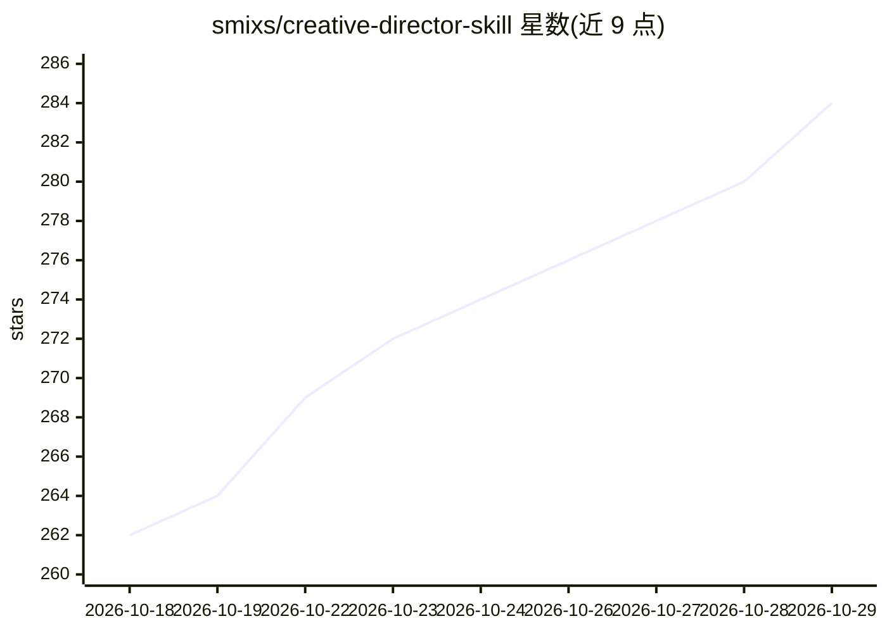

# smixs/creative-director-skill

⭐ 284 · Python · CC-BY-4.0 · 推送 2026-08-08 · [GitHub](https://github.com/smixs/creative-director-skill) · 个人维护

**广告创意方法论技能包：驱动 AI agent 产出并迭代广告创意**

面向 Claude Code 等 70+ AI agent 的创意指导技能（SKILL.md 及 markdown 文件集）：输入任意格式 brief，执行 5 阶段流水线（intake→insight→ideation→evaluate→articulate），调用 20+ 结构化创意方法（SIT、TRIZ、SCAMPER 等）生成 8-12 个概念，按 6 项加权标准与 HumanKind/Grey Scale 评分并递归改进；内置 1950-2025 年 571 个获奖广告案例库（17 轴标签、18 种模式）用于原创性饱和度校验。附 3 个 uv 运行的 Python 维护脚本。核心逻辑为 markdown，无平台锁定。

## 筛选速览

| 维度 | 判定 | 备注 |
|---|---|---|
| AI 角色 | `ai-ecosystem` | LLM/agent 周边工具 |
| 许可风险 | `viral` | CC-BY-4.0 |
| 部署形态 | `library` | 以包/库形式分发 |
| 模型依赖 | — | README 未给出锁定关系 |
| 硬件要求 | — | 无带数字的原话,不猜 |
| 安装摩擦 | `low` | 无编译、无系统依赖或容器化 |
| 成熟度 | — | 结构信号不足 |

## 能力要点

- 5 阶段流水线，evaluate 阶段循环直至达标
- 571 个获奖案例库（17 轴标签、18 种模式 P01-P18）做经验性原创性封顶
- 20+ 方法论分 6 组轮换（结构/联想/反转/扰动/数量/附加）
- 3 套并行评分系统：6 项加权标准、HumanKind、Grey Scale

## 适用场景

- 让 AI agent 按广告公司流程从 brief 产出可交付的创意概念
- 对已有创意做基于案例库的原创性与质量评估
- 在品牌/广告层面进行消费者洞察挖掘

## 场景标签

`提示工程` `AI 写作` · 领域:Agent 开发

## 证据(README 行号)

> L25: An AI creative director that generates advertising concepts using world-class methodologies, scores them against Ca
> L78: ├── SKILL.md                                  # Core skill — phase router + 5-phase workflow
> L214: ### Other AI Agents (Cursor, Windsurf, GPT, Gemini)

## 星数曲线

2026-10-18 262 → 2026-10-29 284（+22）

---
*卡片 v1 · prompt 1.4 · 生成 2026-10-22 · 置信度 high · 依据 README sha `5ad62f994d2c` · [字段定义](../../DATASET.md)*
