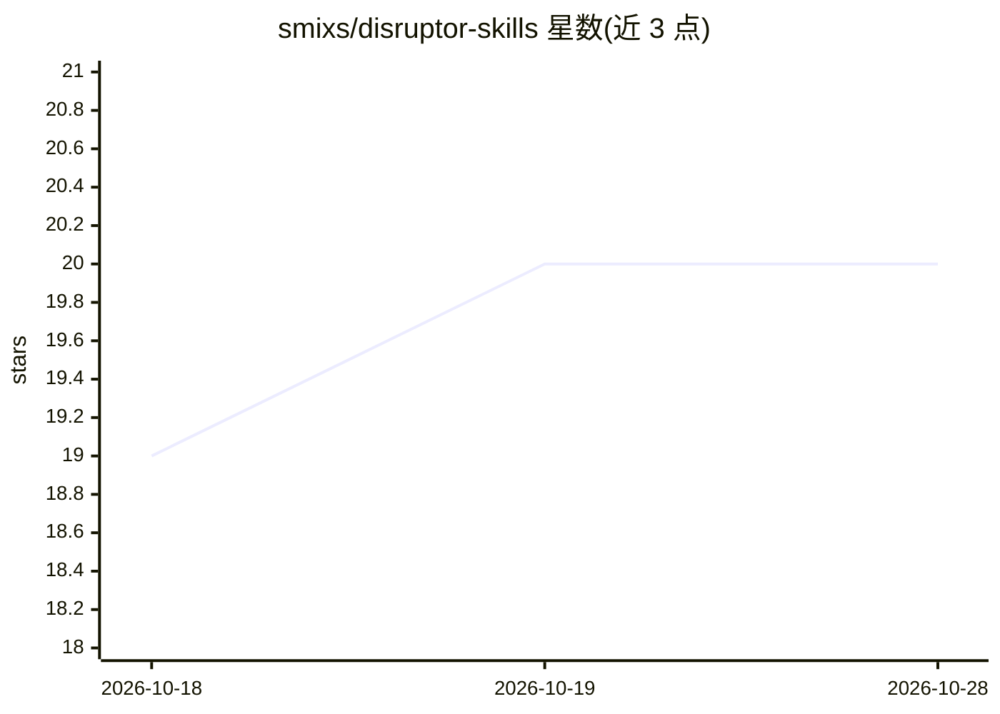

# smixs/disruptor-skills

⭐ 20 · Python · MIT · 推送 2026-07-06 · [GitHub](https://github.com/smixs/disruptor-skills) · [官网](https://t.me/aostrikov_agents_chat) · 组织维护

**12 个 AI 编程 agent 技能：把想法到上线的流程固化为带门禁的流水线**

由 Markdown+YAML frontmatter 写成的 12 个跨 agent 技能（Claude Code、Codex、Cursor、opencode 等原生读取），组成一条从设计（7w3 访谈）、规格、可执行架构护栏、切片、构建收敛评审、QA 到安全部署的门禁流水线（G0–G5）。技能分模型自动触发的方法与用户手动调用的 /command 两类，由 router 决定阶段且拒绝跳步；另有并行子 agent 舰队通道快速产出 MVP。各技能可单独使用，内容译自俄语原始方法，经 npx 安装器或 install.sh/git clone 安装。

## 筛选速览

| 维度 | 判定 | 备注 |
|---|---|---|
| AI 角色 | `ai-ecosystem` | LLM/agent 周边工具 |
| 许可风险 | `permissive` | MIT |
| 部署形态 | `library` | 以包/库形式分发 |
| 模型依赖 | — | README 未给出锁定关系 |
| 硬件要求 | — | 无带数字的原话,不猜 |
| 安装摩擦 | `low` | 无编译、无系统依赖或容器化 |
| 成熟度 | — | 结构信号不足 |

## 能力要点

- 12 个技能串成 idea-to-ship 流水线，router 以 Yes/No 门禁（G0–G5）控制阶段推进
- 技能为纯 Markdown+YAML frontmatter 的跨 agent 开放格式，兼容 Claude Code/Codex/Cursor/opencode
- 7 个模型自动触发方法 + 5 个用户调用 /command；含并行子 agent 舰队通道
- 可与领域技能包（如 emilkowalski/skills）在运行时组合

## 适用场景

- 让编程 agent 按固定门禁流程从设计走到部署，避免其自行宣布完成
- 在代码评审循环中收敛问题并做裁剪式重构评审
- 用并行子 agent 舰队快速搭建可测试 MVP

## 场景标签

`提示工程` `代码审查` · 领域:Agent 开发

## 证据(README 行号)

> L17: **Disruptor** is a set of 12 agent skills for AI-driven software development, stitched into **one idea-to-ship pipe
> L5: **A gated pipeline of 12 agent skills that turns an idea into deployed, production-grade software — design, spec, ex

## 星数曲线

2026-10-18 19 → 2026-10-28 20（+1）

---
*卡片 v1 · prompt 1.4 · 生成 2026-10-28 · 置信度 high · 依据 README sha `802b4bd75421` · [字段定义](../../DATASET.md)*
