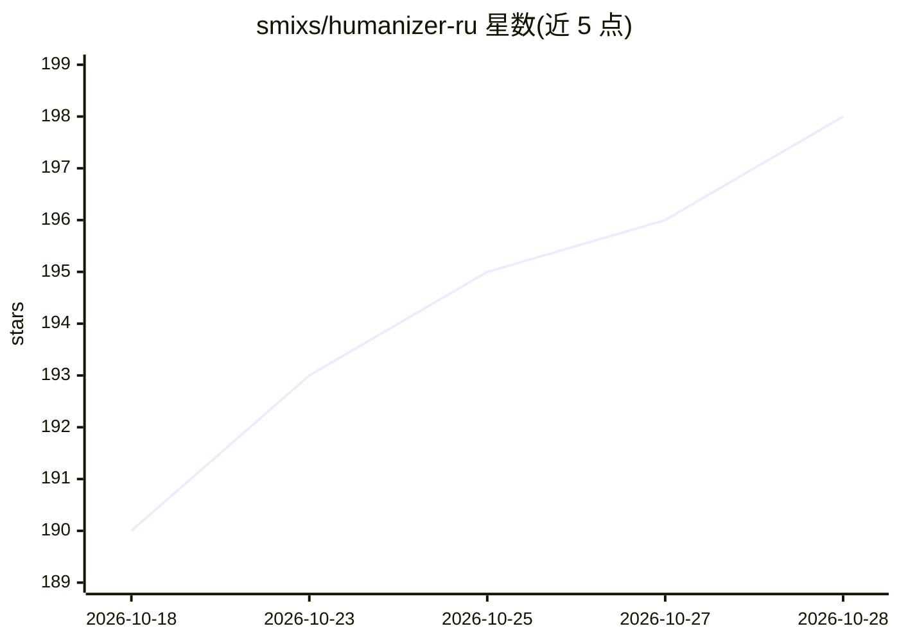

# smixs/humanizer-ru

⭐ 198 · Python · MIT · 推送 2026-09-23 · [GitHub](https://github.com/smixs/humanizer-ru) · 个人维护

**俄语文本 AI 痕迹去除与检测的 agent 技能（SKILL.md）**

面向 Claude Code、Codex、OpenClaw、Hermes 等 AI agent 的技能：对俄语文本按 38 个模式的参考手册查找 AI 生成痕迹（官腔、ChatGPT 套话、破折号、粘贴残留服务标记等），仅修正命中的问题，不动事实与数字，最后用 Python 脚本 lint.py 校验硬性禁令。另提供无修改的检测模式，返回带引文的证据清单与判定。无 Python 时可按手动清单运行；含 19 个 eval 场景、127 项检查。通过 npx skills 安装或 git clone 手动安装。

## 筛选速览

| 维度 | 判定 | 备注 |
|---|---|---|
| AI 角色 | `ai-native` | 本体是模型或模型工具 |
| 许可风险 | `permissive` | MIT |
| 部署形态 | `library` | 以包/库形式分发 |
| 模型依赖 | — | README 未给出锁定关系 |
| 硬件要求 | — | 无带数字的原话,不猜 |
| 安装摩擦 | `low` | 无编译、无系统依赖或容器化 |
| 成熟度 | — | 结构信号不足 |

## 能力要点

- 38 个模式参考手册定位俄语 AI 文本痕迹，仅修改命中处
- 检测模式返回带引文的证据清单与 AI 写作判定
- lint.py 硬性禁令校验，可捕获聊天机器人粘贴标记（如 utm_source=chatgpt.com）
- 19 个 eval 场景共 127 项检查，覆盖事实保全与误改陷阱

## 适用场景

- 把俄语 AI 生成文本改写得更接近人写
- 检验一段俄语文本是否疑似 AI 生成并给出证据
- 在编码 agent 中通过 /humanizer-ru 命令复用该流程

## 场景标签

`AI 写作` · 领域:内容生成

## 证据(README 行号)

> L7: Скилл для AI-агентов: Claude Code, Codex, OpenClaw, Hermes и любых других, читающих SKILL.md. Берёт русский текст по
> L9: Работает в три шага. Сначала ищет проблемы по справочнику из 38 паттернов, потом чинит только найденное, в конце гон
> L66: 19 eval-сценариев, 127 проверок: сохранность фактов и цифр, ловушки на замену слопа синонимами, чистые тексты, кото

## 星数曲线

2026-10-18 190 → 2026-10-28 198（+8）

---
*卡片 v1 · prompt 1.4 · 生成 2026-10-23 · 置信度 high · 依据 README sha `3e5d9f412cd9` · [字段定义](../../DATASET.md)*
