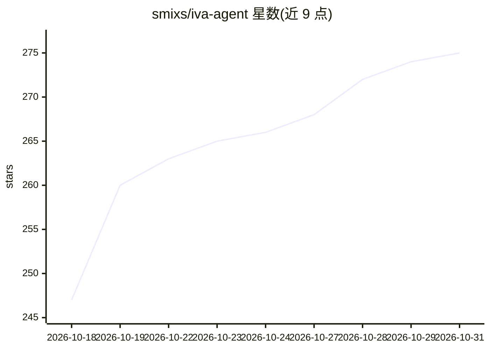

# smixs/iva-agent

⭐ 275 · TypeScript · MIT · 推送 2026-10-26 · [GitHub](https://github.com/smixs/iva-agent) · [官网](https://iva-agent.com) · 个人维护 · 中文 README

**自托管的 Telegram 个人 AI 助理，带分层长期记忆**

部署在自己服务器上的 Telegram AI 助理：把语音、文字、照片、转发内容整理为 Obsidian 兼容的 markdown vault，形成按日/周/月/年折叠的分层记忆树（CORE.md 常驻提示词），并带个人 CRM、任务提醒、语义搜索、Google Workspace 集成与 MCP 技能扩展。语音转录用 Deepgram，模型支持六种供应商。通过 curl 安装脚本一键部署，以 systemd 用户服务运行。需注意模型与转录依赖用户自选自付费的云 API，个人账号 userbot 功能违反 Telegram ToS 需自担风险。

## 筛选速览

| 维度 | 判定 | 备注 |
|---|---|---|
| AI 角色 | `ai-native` | 本体是模型或模型工具 |
| 许可风险 | `permissive` | MIT |
| 部署形态 | `None` |  |
| 模型依赖 | — | README 未给出锁定关系 |
| 硬件要求 | — | 无带数字的原话,不猜 |
| 安装摩擦 | `low` | 无编译、无系统依赖或容器化 |
| 成熟度 | — | 结构信号不足 |

## 能力要点

- 分层记忆树：逐日消息 + 周月年摘要 + CORE.md 常驻提示词
- 语音/照片/转发内容转为 Obsidian 兼容 markdown 卡片
- 六种模型供应商可选，含自建 OpenAI 兼容端点
- 提示注入过滤、密钥脱敏、只读模式等安全机制

## 适用场景

- 在 Telegram 里记录语音备忘并自动生成任务与联系人卡片
- 数月后回查与客户的约定和决策记录
- 通过聊天操作 Gmail/Calendar/Docs 等 Google Workspace 功能

## 场景标签

`Agent 记忆` `AI 助手` `知识库管理` · 领域:Agent 开发

## 证据(README 行号)

> L13: Iva is a self-hosted Telegram AI assistant with layered memory that turns your messages into an Obsidian-compatible
> L39: How Iva works: voice, text, photos and PDFs fly from Telegram into the willow-tree agent, wired to memory, nightly 

## 星数曲线

2026-10-18 247 → 2026-10-31 275（+28）

---
*卡片 v1 · prompt 1.4 · 生成 2026-10-22 · 置信度 high · 依据 README sha `05a945f51642` · [字段定义](../../DATASET.md)*
