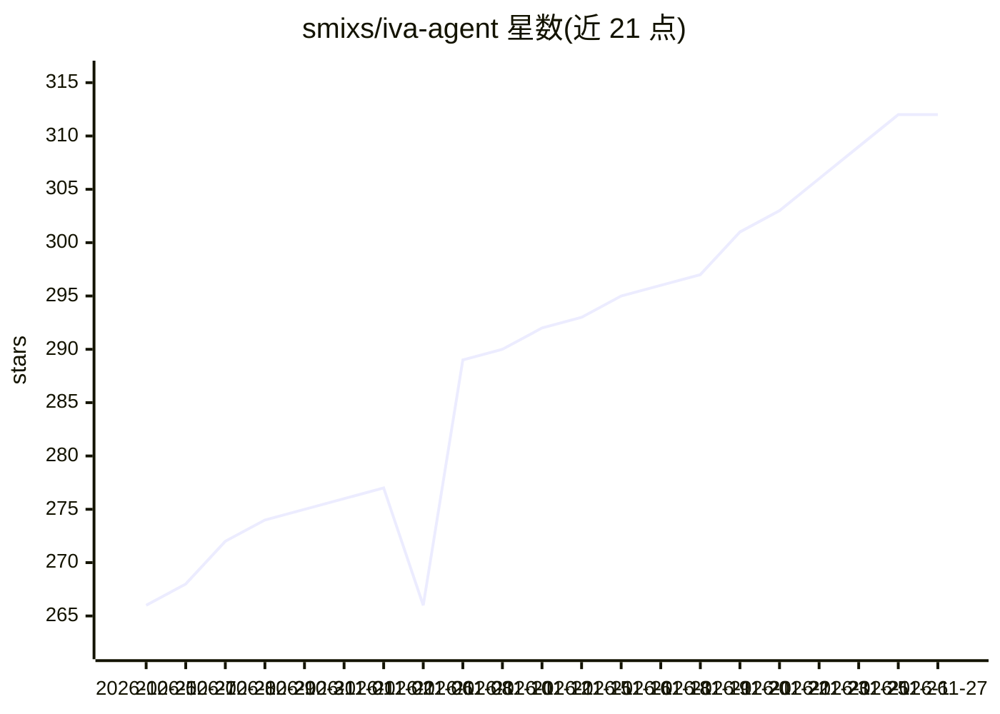

# smixs/iva-agent

⭐ 312 · TypeScript · MIT · 推送 2026-11-26 · [GitHub](https://github.com/smixs/iva-agent) · [官网](https://iva-agent.com) · 个人维护

**自托管的 Telegram 个人 AI 助手：分层记忆帮你管理事务**

IVA 是部署在自己服务器上的 Telegram AI 助手，将语音、照片、转发消息与决策转为 Obsidian 兼容的纯 markdown 笔记库，通过逐日日志、每夜汇总与 CORE.md 核心文件实现跨月分层记忆。提供语音转写、图像描述、个人 CRM、任务提醒、语义搜索、Google Workspace 操作、userbot 代读群聊等功能；入口与输出均由提示注入过滤和密钥脱敏门处理。以 Ubuntu/Debian 一键脚本或 git clone 源码安装，以 systemd 服务运行。

## 筛选速览

| 维度 | 判定 | 备注 |
|---|---|---|
| AI 角色 | `ai-native` | 本体是模型或模型工具 |
| 许可风险 | `permissive` | MIT |
| 部署形态 | `None` |  |
| 模型依赖 | local-ok | 支持本地模型 |
| 硬件要求 | — | 无带数字的原话,不猜 |
| 安装摩擦 | `low` | 无编译、无系统依赖或容器化 |
| 成熟度 | — | 结构信号不足 |

## 能力要点

- 分层记忆树：逐日 verbatim 日志 + 每夜 04:00 汇总为 day→week→month→year 卡片
- 消息经提示注入过滤门后才进入模型，出站经密钥脱敏门与允许名单（fail closed）
- 六个模型提供方可选，含 Ollama Cloud、OpenRouter 与自定义 OpenAI 兼容端点
- 可选 userbot 从本人账号读群聊并代回复，带服务端 FloodWait/随机延迟/熔断护栏

## 适用场景

-  months 后仍能检索与某客户的约定或历史决策
- 把五分钟语音备忘自动转成任务清单和会议卡片
- 让助手代为跟进联系人、生成报价文档并回传链接
- 让 userbot 代读未跟上的群聊并汇总要点

## 场景标签

`AI 助手` `知识库管理` `语义搜索` · 领域:对话与助手

## 证据(README 行号)

> L15: Iva is a self-hosted Telegram AI assistant with layered memory that turns your messages into an Obsidian-compatible
> L53: - **Voice** — voice, audio and video notes transcribed with Deepgram nova-3; auto-detects ru/uz/en.
> L171: Default model is deepseek-v4-pro, 131k context. On Go it runs about $14–15/mo all-in ($10 model + $4–5 VPS; the mo

## 星数曲线

2026-10-25 266 → 2026-11-27 312（+46）

---
*卡片 v1 · prompt 1.4 · 生成 2026-11-27 · 置信度 high · 依据 README sha `43286cc0c001` · [字段定义](../../DATASET.md)*
