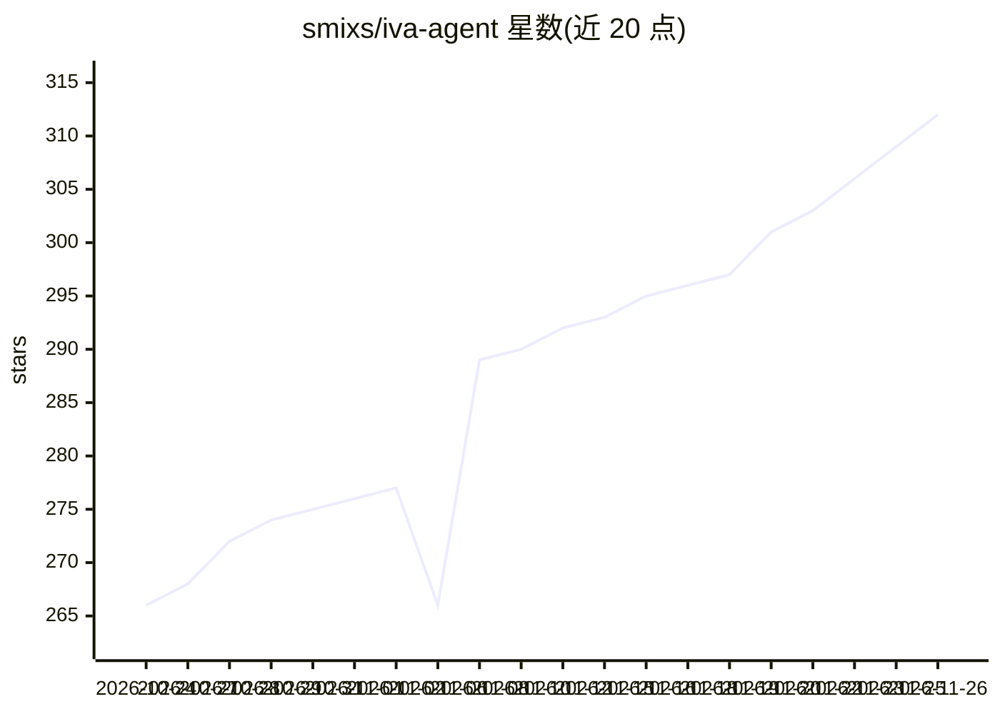

# smixs/iva-agent

⭐ 312 · TypeScript · MIT · 推送 2026-11-25 · [GitHub](https://github.com/smixs/iva-agent) · [官网](https://iva-agent.com) · 个人维护

**自托管的 Telegram 个人 AI 助手，把消息沉淀为可检索的记忆库**

以 Telegram bot 形式运行的自托管个人助手：语音（Deepgram 转写）、照片、转发消息与决定被写入 Obsidian 兼容的纯 markdown vault；采用分层记忆结构（每日逐字日志、日/周/月/年汇总、CORE.md 核心文件随每条 prompt）。检索用 BM25 加链接图重排，可选向量模式；提供个人 CRM、任务提醒、Google Workspace 操作、userbot 以本人账号读群等能力。安装为一条 curl 脚本，以 systemd 用户服务运行；模型与转写依赖用户自选的云 API。

## 筛选速览

| 维度 | 判定 | 备注 |
|---|---|---|
| AI 角色 | `ai-native` | 本体是模型或模型工具 |
| 许可风险 | `permissive` | MIT |
| 部署形态 | `None` |  |
| 模型依赖 | local-ok | 支持本地模型 |
| 硬件要求 | — | 无带数字的原话,不猜 |
| 安装摩擦 | `low` | 无编译、无系统依赖或容器化 |
| 成熟度 | — | 结构信号不足 |

## 能力要点

- 分层记忆：每日逐字日志 + 04:00 夜间汇总生成 schema 校验卡片
- Obsidian 兼容 vault，数据与密钥留在自托管服务器
- userbot 以个人账号读群并代回复，带服务端防封禁机制
- prompt 注入消毒门与出站密钥脱敏门

## 适用场景

- 在 Telegram 里保存并回查数月前的约定与决定
- 语音便签自动转成任务清单和会议卡片
- 以本人账号浏览群聊摘要并代为回复
- 聊天中直接操作 Gmail/Calendar/Drive/Docs

## 场景标签

`Agent 记忆` `AI 助手` `知识库管理` `知识图谱` · 领域:Agent 开发

## 证据(README 行号)

> L15: Iva is a self-hosted Telegram AI assistant with layered memory that turns your messages into an Obsidian-compatible
> L53: - **Voice** — voice, audio and video notes transcribed with Deepgram nova-3; auto-detects ru/uz/en.
> L160: Six model providers. Pick one and fill its block in `.env`:

## 星数曲线

2026-10-24 266 → 2026-11-26 312（+46）

---
*卡片 v1 · prompt 1.4 · 生成 2026-11-25 · 置信度 high · 依据 README sha `45bc8758234d` · [字段定义](../../DATASET.md)*
