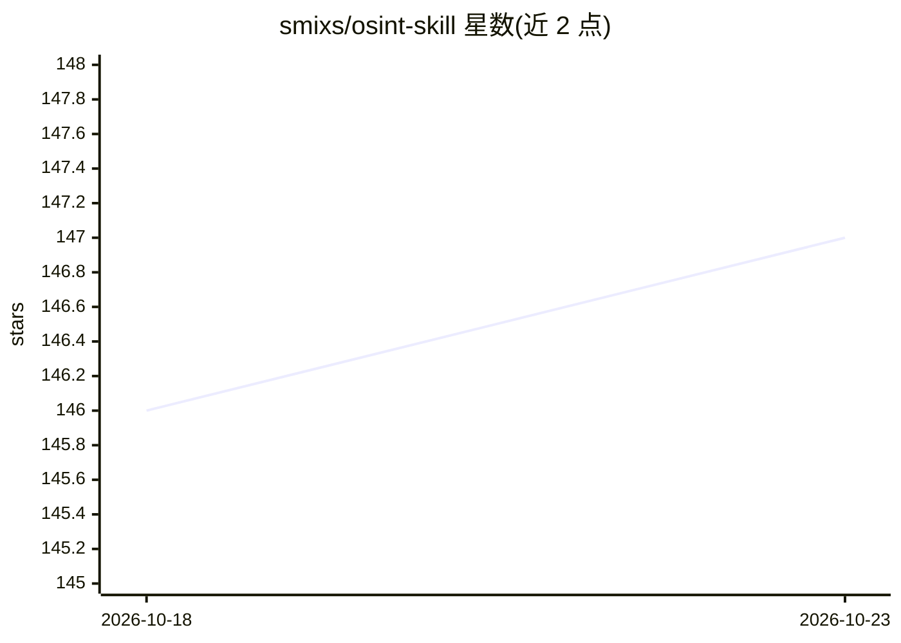

# smixs/osint-skill

⭐ 147 · Shell · MIT · 推送 2026-03-10 · [GitHub](https://github.com/smixs/osint-skill) · [官网](https://github.com/smixs/osint-skill#readme) · 个人维护 · 中文 README

**AI 编码代理的 OSINT 技能包：从姓名生成人物情报档案**

以 SKILL.md 格式分发的开源情报技能，兼容 Claude Code、OpenClaw、Codex、OpenCode 等 AI 代理：给定姓名或用户名，通过 0-6 阶段流水线执行系统性情报搜集，聚合 55+ Apify actor（Instagram/Facebook/TikTok/YouTube/LinkedIn 抓取）与 7 种搜索 API（Brave/Jina/Perplexity/Exa/Tavily 等），产出含 MBTI/大五人格画像、职业地图与置信度分级（A/B/C/D）的评分档案。支持 3-5 个并行子代理的 Swarm 模式、四级研究升级（免费至 $0.50）与预算控制（超 $0.50 需授权）。声明 Early Beta，已知问题包括 shell 注入、macOS 兼容缺陷与 Apify actor ID 变动。依赖 curl/python3/jq，Apify 路径需 Node.js 18+。

## 筛选速览

| 维度 | 判定 | 备注 |
|---|---|---|
| AI 角色 | `ai-native` | 本体是模型或模型工具 |
| 许可风险 | `permissive` | MIT |
| 部署形态 | `library` | 以包/库形式分发 |
| 模型依赖 | — | README 未给出锁定关系 |
| 硬件要求 | — | 无带数字的原话,不猜 |
| 安装摩擦 | `low` | 无编译、无系统依赖或容器化 |
| 成熟度 | `idea` | |

## 能力要点

- 0-6 阶段研究流水线与四级研究升级（免费至 $0.50）
- 嵌入 55+ Apify actor 覆盖 Instagram/Facebook/TikTok/YouTube/LinkedIn 等平台
- 基于内容分析（YouTube 字幕、Telegram 消息、博客）的 MBTI/大五人格画像
- 每条事实按独立佐证数分级 A/B/C/D 置信度

## 适用场景

- 用 AI 代理对目标人物做背景调查与尽职调查
- 从姓名或网络用户名出发生成含心理画像与职业地图的情报档案
- 在预算与置信度控制下按需逐步加深人物研究

## 场景标签

`网络安全` · 领域:学习与行业

## 证据(README 行号)

> L11: Systematic intelligence gathering on individuals. From a name or handle to a scored dossier with psychoprofile, car
> L30: - **Swarm Mode**: coordinates 3-5 parallel sub-agents on Sonnet for speed
> L33: - **Confidence Scoring**: every fact gets graded A/B/C/D by number of independent confirmations

## 星数曲线

2026-10-18 146 → 2026-10-23 147（+1）

---
*卡片 v1 · prompt 1.4 · 生成 2026-10-22 · 置信度 mid · 依据 README sha `9d6e5fda89d3` · [字段定义](../../DATASET.md)*
