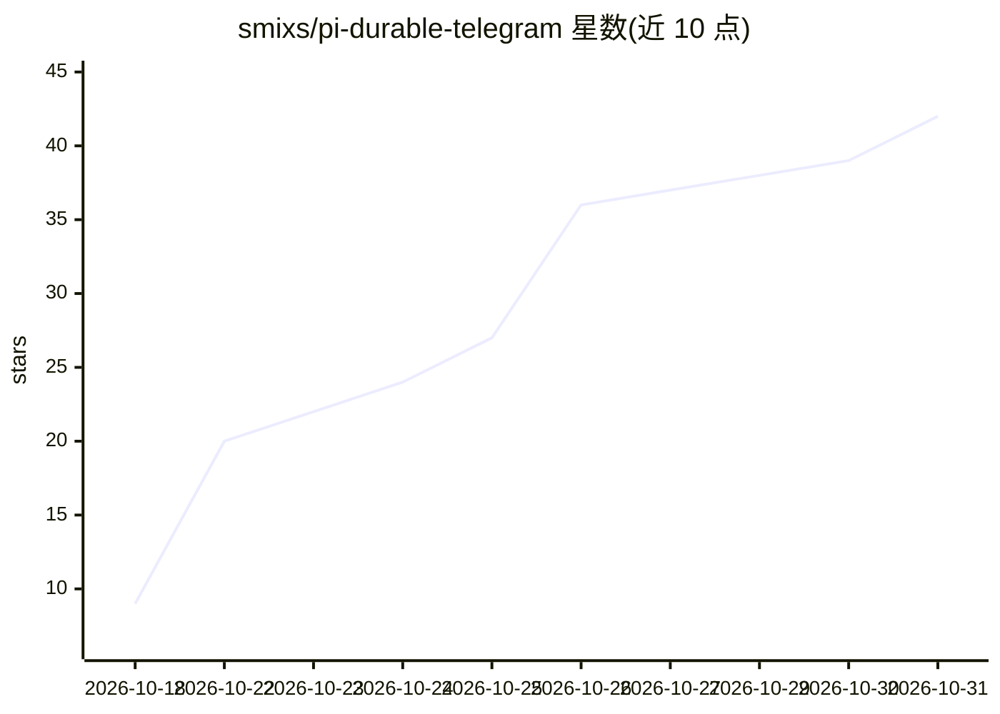

# smixs/pi-durable-telegram

⭐ 42 · TypeScript · MIT · 推送 2026-10-24 · [GitHub](https://github.com/smixs/pi-durable-telegram) · [官网](https://github.com/smixs/pi-durable-telegram#readme) · 个人维护

**部署在自己服务器上的常驻 pi agent，通过 Telegram 对话使用**

构建于开源编码 agent pi 及其持久化引擎 pi-durable 之上的 Telegram 网关：在 Linux 服务器上以 systemd 用户服务运行，长轮询 Telegram Bot API，每个获准私聊对应一个持久会话，存于 SQLite。agent 在崩溃或重启后可从断点恢复并完成回答，忙时消息排队按序应答；提供 bash/read/write/edit 等工具与搜索、MCP、提醒等插件。需自备 AI 订阅或 API key，模型支持 pi 所支持的提供商；仅支持私聊，暂不支持群聊。

## 筛选速览

| 维度 | 判定 | 备注 |
|---|---|---|
| AI 角色 | `ai-native` | 本体是模型或模型工具 |
| 许可风险 | `permissive` | MIT |
| 部署形态 | `library` | 以包/库形式分发 |
| 模型依赖 | — | README 未给出锁定关系 |
| 硬件要求 | — | 无带数字的原话,不猜 |
| 安装摩擦 | `low` | 无编译、无系统依赖或容器化 |
| 成熟度 | — | 结构信号不足 |

## 能力要点

- 每一步先落盘，崩溃/重启后从书签处恢复并恰好回答一次
- 消息队列化按序应答，agent 忙时无需等待
- 插件机制：网页搜索、MCP、技能、助手拆分、定时任务
- 仅响应白名单 Telegram 账号，数据留在服务器

## 适用场景

- 从手机随时让服务器上的 agent 排查故障或处理文件
- 发送照片/PDF/语音让 agent 读取并回复
- 让 agent 承担定时任务并主动通知我

## 场景标签

`AI 助手` `编码 Agent` · 领域:编码与开发

## 证据(README 行号)

> L7: **Your own AI agent that lives on your server and answers you in Telegram.**
> L17: Built on pi, an open-source coding agent, and its new durable engine
> L168: that long-polls the Telegram Bot API. One durable conversation per allowed private chat, stored in SQLite. Tools:

## 星数曲线

2026-10-18 9 → 2026-10-31 42（+33）

---
*卡片 v1 · prompt 1.4 · 生成 2026-10-26 · 置信度 high · 依据 README sha `4e3a12717810` · [字段定义](../../DATASET.md)*
