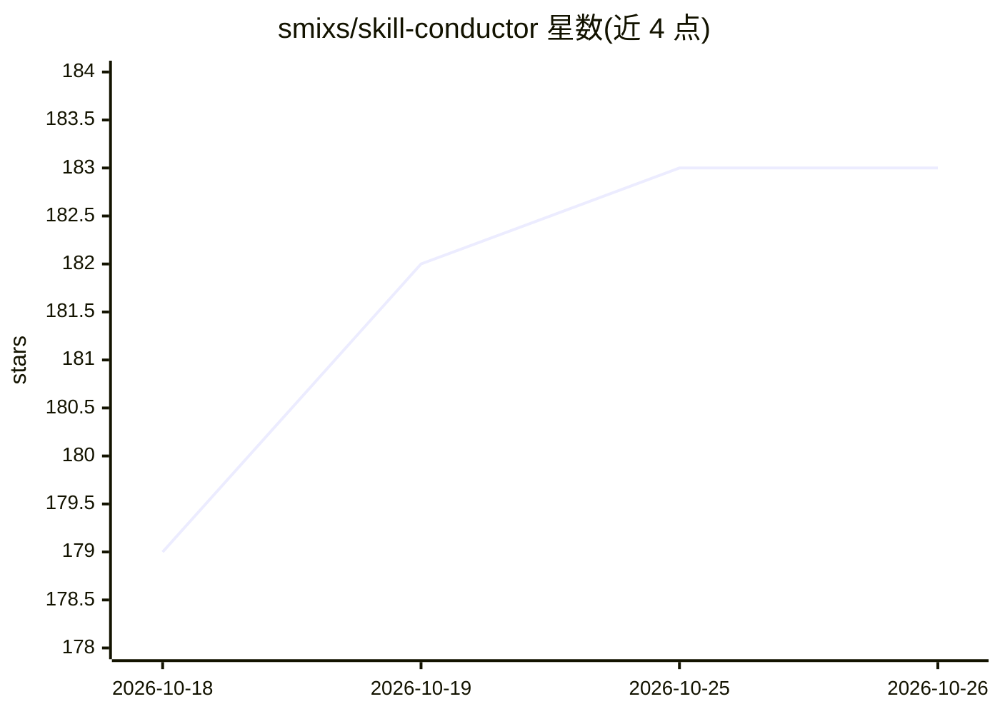

# smixs/skill-conductor

⭐ 183 · Python · MIT · 推送 2026-08-03 · [GitHub](https://github.com/smixs/skill-conductor) · [官网](https://t.me/aimastersme) · 个人维护

**为 AI agent 技能提供创建/评测/改进全流程的元级技能工具**

面向 Claude Code 等 agent 框架的技能生命周期工具：先选架构（5 种模式）再写 SKILL.md，流程覆盖 design→build→test→evaluate→package。评测采用 BinEval 二元问答（每题带证据、关键题门控），配三类专业 agent（grader/comparator/bineval）、跨模型家族校准、阈值盲判与留出集门控的自更新循环。提供 6 种模式（CREATE/IMPROVE/VALIDATE/REVIEW/OPTIMIZE/PACKAGE），可通过 npx 或 Claude Code 插件市场安装。

## 筛选速览

| 维度 | 判定 | 备注 |
|---|---|---|
| AI 角色 | `ai-ecosystem` | LLM/agent 周边工具 |
| 许可风险 | `permissive` | MIT |
| 部署形态 | `library` | 以包/库形式分发 |
| 模型依赖 | — | README 未给出锁定关系 |
| 硬件要求 | — | 无带数字的原话,不猜 |
| 安装摩擦 | `low` | 无编译、无系统依赖或容器化 |
| 成熟度 | — | 结构信号不足 |

## 能力要点

- 架构优先：5 种技能架构模式须先选定再编写
- BinEval 二元问答评测，关键题门控而非分数阈值
- 阈值盲判、跨模型家族校准与留出集门控的自更新循环
- 6 种模式覆盖创建、改进、验证、第三方技能审查、描述优化与打包

## 适用场景

- 为 agent 系统性地创建与打磨 SKILL.md 技能
- 在安装第三方技能前做质量门控审查
- 自动优化技能描述以提升触发准确率

## 场景标签

`提示工程` `模型评测` · 领域:Agent 开发

## 证据(README 行号)

> L5: > A skill that creates, evaluates, and improves other skills. Meta-level.
> L111: |Mode|What it does|
> L152: **Claude Code:** the install commands above drop it into `.claude/skills/`. Auto-activates when the agent detects 

## 星数曲线

2026-10-18 179 → 2026-10-26 183（+4）

---
*卡片 v1 · prompt 1.4 · 生成 2026-10-23 · 置信度 high · 依据 README sha `8bbe9c64c6bd` · [字段定义](../../DATASET.md)*
