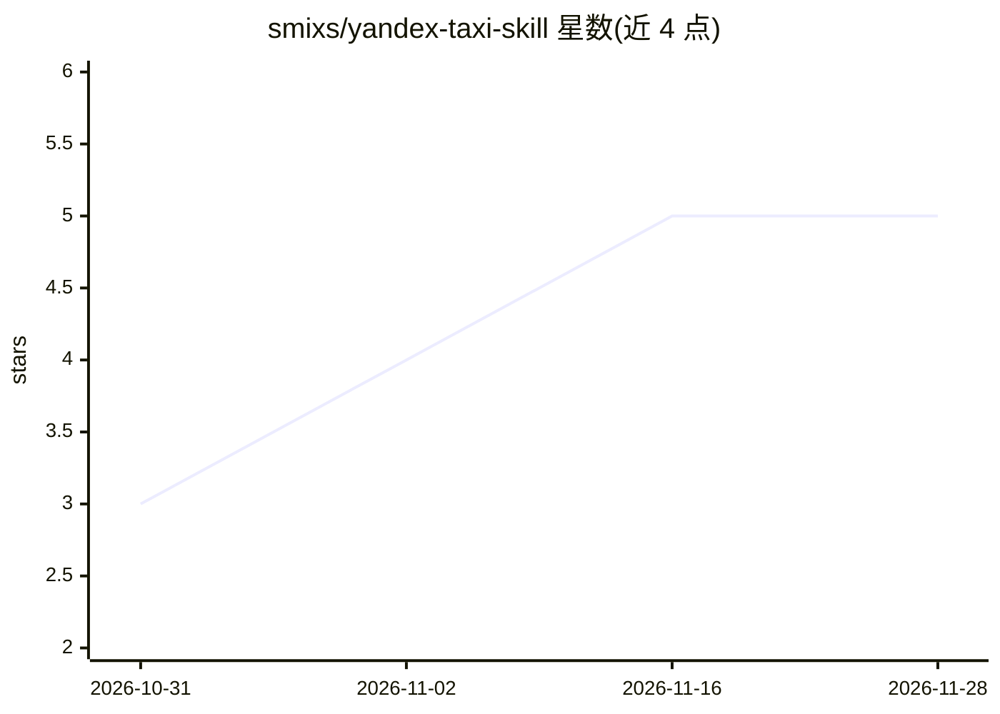

# smixs/yandex-taxi-skill

⭐ 5 · Shell · MIT · 推送 2026-10-26 · [GitHub](https://github.com/smixs/yandex-taxi-skill) · 个人维护

**让 AI 代理代为查询并下单 Yandex Taxi 的技能包**

以 Agent Skills 格式发布的技能包，供 Iva、Claude Code、Codex 等带 shell 与浏览器的代理调用：通过 agent-browser 无头浏览器打开 taxi.yandex.uz，读取资费与价格、按白名单选择车型、检查支付卡并生成摘要，仅在用户明确确认后由 confirm --yes 按下下单按钮，支持报价、准备、状态与关单等子命令。登录经二维码保存在本地 state.json（权限 600），全程本地运行、无服务器。仅在乌兹别克斯坦站点实测，最终下单与跟车未经端到端验证，适配器未在 Claude Code/Codex 内实际运行。

## 筛选速览

| 维度 | 判定 | 备注 |
|---|---|---|
| AI 角色 | `ai-enhanced` | 去掉 AI 部分产品仍成立 |
| 许可风险 | `permissive` | MIT |
| 部署形态 | `None` |  |
| 模型依赖 | — | README 未给出锁定关系 |
| 硬件要求 | — | 无带数字的原话,不猜 |
| 安装摩擦 | `low` | 无编译、无系统依赖或容器化 |
| 成熟度 | `idea` | |

## 能力要点

- 经 agent-browser 驱动 taxi.yandex.uz 网站，无官方公开下单 API
- 分阶段 stage 检查（浏览器/地理封锁/配置/登录/卡片）并映射到参考文件
- 仅 confirm --yes 可下单，车型白名单与指定卡片限制，默认等待用户确认
- 登录凭据本地存储（mode 600、不入 git、不发送到聊天）

## 适用场景

- 让日常使用的 AI 代理帮我在 Telegram 里叫车并跟踪车辆
- 只询问机场打车价格而不下单
- 限制代理只能选择我允许的车型和支付卡

## 场景标签

`浏览器自动化` · 领域:效率与自动化

## 证据(README 行号)

> L13: **Yandex Taxi Skill** is a portable skill for AI agents. You say "taxi to the airport" in Telegram (or any chat), a
> L15: It is for people who live where Yandex Taxi works (Uzbekistan, Russia, Kazakhstan and nearby) and already use an AI
> L41: One script, `scripts/yandex-taxi.sh`, does the fragile browser steps: `preflight`, `stage`, `state-check`, `state-s

## 星数曲线

2026-10-31 3 → 2026-11-28 5（+2）

---
*卡片 v1 · prompt 1.4 · 生成 2026-11-21 · 置信度 high · 依据 README sha `61bbc7e5a0c0` · [字段定义](../../DATASET.md)*
