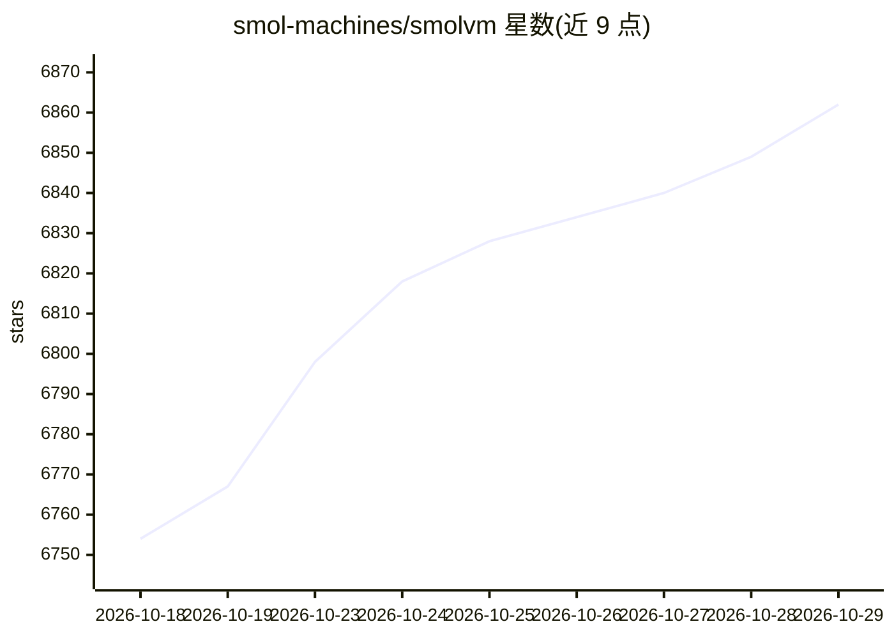

# smol-machines/smolvm

⭐ 6,862 · Rust · Apache-2.0 · 推送 2026-10-28 · [GitHub](https://github.com/smol-machines/smolvm) · [官网](https://smolmachines.com) · 个人维护

**面向 AI agent 的可嵌入、可分支本地 microVM 运行时**

基于 libkrun 的轻量虚拟机运行时：每个工作负载运行在独立内核的硬件隔离 VM 中，启动低于 200ms，支持任意 OCI 镜像、无需 Docker daemon。提供 CLI 与 Node/Python/Rust 进程内 SDK（无守护进程），可对运行中的机器做检查点、回退与写时复制分支，打包为 .smolmachine 便携产物推送至 OCI registry。网络默认关闭、可按主机白名单限制出口、凭证代换不暴露明文。支持 macOS/Linux/Windows 平台，KVM/WHP 为系统前提，GPU 加速不可用。

## 筛选速览

| 维度 | 判定 | 备注 |
|---|---|---|
| AI 角色 | `ai-ecosystem` | LLM/agent 周边工具 |
| 许可风险 | `permissive` | Apache-2.0 |
| 部署形态 | `desktop` | 安装包/桌面程序 |
| 模型依赖 | — | README 未给出锁定关系 |
| 硬件要求 | — | 无带数字的原话,不猜 |
| 安装摩擦 | `medium` | 含编译或系统依赖之一 |
| 成熟度 | — | 结构信号不足 |

## 能力要点

- 检查点捕获 RAM/CPU 状态与磁盘，支持回退与写时复制分支
- Node/Python/Rust 进程内嵌入 SDK，无守护进程
- 网络默认关闭，支持主机白名单与凭证代换
- 机器可打包为单个 .smolmachine 文件或推送 OCI registry

## 适用场景

- 为 AI agent 提供安全隔离的本地代码执行沙箱
- 将运行中的开发环境分支成多个副本并行试验
- 跨主机迁移或恢复带完整执行状态的虚拟机

## 场景标签

 · 领域:虚拟化/AI 基础设施

## 证据(README 行号)

> L12: **Branchable microVMs for AI agents.**
> L49: Drive machines from your own code with one `Machine` API. The SDKs run in your process with no daemon, locally or o
> L97: Each workload gets a hardware-isolated VM with its own kernel. Networking is off by default, egress can be limited 

## 星数曲线

2026-10-18 6,754 → 2026-10-29 6,862（+108）

---
*卡片 v1 · prompt 1.4 · 生成 2026-10-20 · 置信度 high · 依据 README sha `e0ae28e9d4dc` · [字段定义](../../DATASET.md)*
