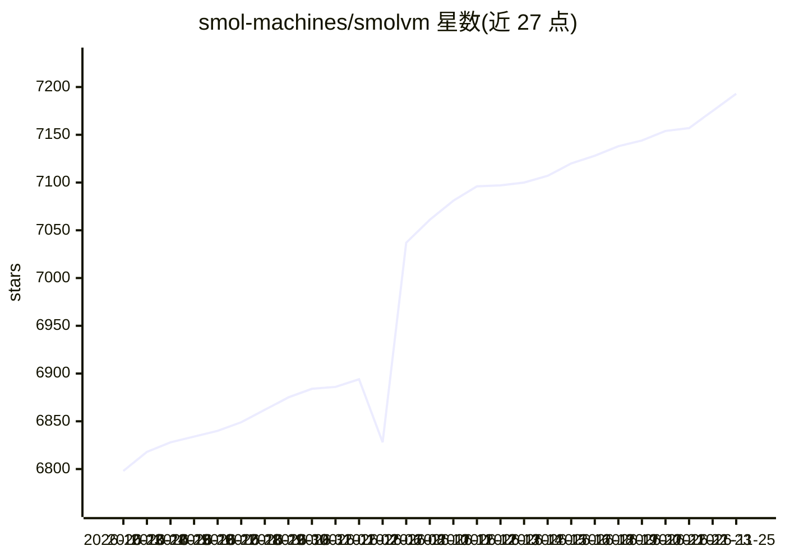

# smol-machines/smolvm

⭐ 7,193 · Rust · Apache-2.0 · 推送 2026-11-23 · [GitHub](https://github.com/smol-machines/smolvm) · [官网](https://smolmachines.com) · 组织维护 · 中文 README

**为 AI Agent 提供本地可嵌入、可分支 microVM 沙箱的运行时**

smolvm 是 smol machines 背后的开源运行时，将硬件虚拟化的 microVM（libkrun 作为 VMM，OCI 镜像格式）嵌入到软件或本地沙箱中：支持秒级启动、弹性内存、运行中检查点与 copy-on-write 分支、打包为单个 .smolmachine 便携文件，并提供 Node/Python/Rust/Go 的 Machine SDK。网络默认关闭，可通过 --allow-host 限制出口、凭据以占位符注入。需要宿主机虚拟化能力（macOS Hypervisor.framework、Linux KVM、Windows WHP），GPU 加速暂不可用。

## 筛选速览

| 维度 | 判定 | 备注 |
|---|---|---|
| AI 角色 | `ai-ecosystem` | LLM/agent 周边工具 |
| 许可风险 | `permissive` | Apache-2.0 |
| 部署形态 | `desktop` | 安装包/桌面程序 |
| 模型依赖 | — | README 未给出锁定关系 |
| 硬件要求 | — | 无带数字的原话,不猜 |
| 安装摩擦 | `low` | 无编译、无系统依赖或容器化 |
| 成熟度 | — | 结构信号不足 |

## 能力要点

- 提供 Node/Python/Rust/Go 四种语言 SDK，可在进程内直接驱动 VM、无守护进程
- 支持运行中检查点与 copy-on-write 分支，检查点可在 arm64 Mac 与 arm64 Linux 之间迁移
- 机器可打包为 .smolmachine 单文件，推送到 OCI 注册表或作为自包含可执行文件运行（<200ms 启动）
- 安全模型：每工作负载独立 VM 与内核，网络默认关闭，支持主机白名单与凭据替换

## 适用场景

- 在本机沙箱中安全运行不可信的 Agent 代码
- 为 AI Agent 提供可嵌入的一次性代码执行环境
- 将开发环境打包为便携文件在团队与主机间分发
- 在本地以 microVM 方式运行任意 OCI 镜像而无需 Docker 守护进程

## 场景标签

`Agent 框架` · 领域:Agent 开发

## 证据(README 行号)

> L14: **Branchable microVMs for AI agents.**
> L15: Embed lightweight virtual machines into your software, portable dev environments, and local sandboxing.
> L121: Each workload runs in a hardware-virtualized VM with its own guest kernel on Hypervisor.framework (macOS), KVM (Li

## 星数曲线

2026-10-23 6,798 → 2026-11-25 7,193（+395）

---
*卡片 v1 · prompt 1.4 · 生成 2026-11-22 · 置信度 mid · 依据 README sha `1192bca1dfeb` · [字段定义](../../DATASET.md)*
