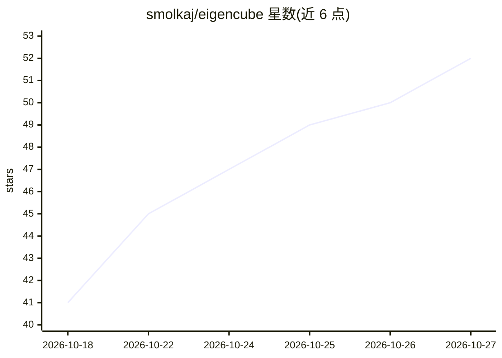

# smolkaj/eigencube

⭐ 52 · Python · Apache-2.0 · 推送 2026-10-12 · [GitHub](https://github.com/smolkaj/eigencube) · [官网](https://youtu.be/kRrK4VJBf2s) · 个人维护

**用线性代数求解魔方的 Python 求解器与可视化工具**

以离散三维线性代数（向量、旋转矩阵、点积）建模魔方，配合分层多阶段 A* 搜索与即时启发式距离估计，在不使用查找表和预计算模式库的前提下求解任意打乱状态，Python 参考实现严格控制在 400 行内。提供 Pygame 2D 可视化界面、命令行求解器、Python API 与测试套件，另有 OCaml 与 Rust 移植版本。典型打乱在 5–25 秒内求解（Python 版），rust_fast 版可加速至约 0.02–0.03 秒。代码以'Functional Pearl'风格写成，强调可读性与教学性。

## 筛选速览

| 维度 | 判定 | 备注 |
|---|---|---|
| AI 角色 | `ai-native` | 本体是模型或模型工具 |
| 许可风险 | `permissive` | Apache-2.0 |
| 部署形态 | `self-host` | docker 或自建部署 |
| 模型依赖 | — | README 未给出锁定关系 |
| 硬件要求 | — | 无带数字的原话,不猜 |
| 安装摩擦 | `low` | 无编译、无系统依赖或容器化 |
| 成熟度 | — | 结构信号不足 |

## 能力要点

- 线性代数建模魔方状态与转动，零查找表零预计算模式库
- 分层多阶段 A* 搜索，Python 实现严格低于 400 行
- 提供 Pygame 可视化、命令行求解器与 Python API
- 含 OCaml 与两个 Rust 移植版本及各自独立测试套件

## 适用场景

- 我想可视化观察魔方的打乱与逐步还原过程
- 我想从命令行或 Python API 中程序化求解魔方
- 我想学习用线性代数建模魔方的算法实现

## 场景标签

 · 领域:算法/益智求解

## 证据(README 行号)

> L38: `eigencube.py` implements a **hierarchical multi-phase A\* search** that mimics human layer-by-layer reduction, sta
> L48: A\* needs a sense of direction so it doesn't search aimlessly. Rather than storing gigabytes of precomputed lookup 

## 星数曲线

2026-10-18 41 → 2026-10-27 52（+11）

---
*卡片 v1 · prompt 1.4 · 生成 2026-10-24 · 置信度 mid · 依据 README sha `3ac1fe9138a1` · [字段定义](../../DATASET.md)*
