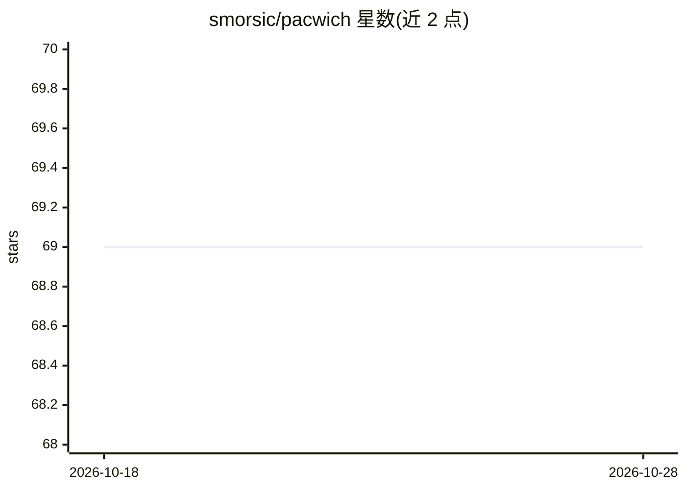

# smorsic/pacwich

⭐ 69 · TypeScript · MIT · 推送 2026-10-22 · [GitHub](https://github.com/smorsic/pacwich) · [官网](https://pacwich.dev) · 个人维护

**面向 Bun/npm/pnpm workspaces 的零配置 monorepo 工具（CLI+TS API）**

构建在 Bun、npm、pnpm workspaces 之上的 monorepo 工具，提供跨 workspace 运行脚本、获取 monorepo 元数据、affected 依赖图与 workspace 代码共享规则等功能。verify 特性通过分析 JS/TS 的 import/export，捕获隐式与祖先级 workspace 依赖问题，可接入 pre-commit 或 CI。提供全局/本地 CLI 与 TypeScript 库 API，零必需配置，另有可选的 workspace/project 配置文件。前身为仅支持 Bun 的 bun-workspaces 包。

## 筛选速览

| 维度 | 判定 | 备注 |
|---|---|---|
| AI 角色 | `ai-ecosystem` | LLM/agent 周边工具 |
| 许可风险 | `permissive` | MIT |
| 部署形态 | `library` | 以包/库形式分发 |
| 模型依赖 | — | README 未给出锁定关系 |
| 硬件要求 | — | 无带数字的原话,不猜 |
| 安装摩擦 | `low` | 无编译、无系统依赖或容器化 |
| 成熟度 | — | 结构信号不足 |

## 能力要点

- 支持 Bun/npm/pnpm 三种 workspaces，零必需配置
- verify 特性分析 import/export 捕获未显式声明的 workspace 依赖
- 提供 affected 依赖图与 workspace 代码共享规则
- CLI 与 TypeScript 库 API 双形态，可选配置文件

## 适用场景

- 在 monorepo 中跨 workspace 运行与编排 package.json 脚本
- 在 CI 或 pre-commit 中检查 workspace 依赖未显式声明的问题
- 通过 TS API 程序化获取 monorepo 元数据与依赖图

## 场景标签

 · 领域:前端工程化/monorepo 工具

## 证据(README 行号)

> L9: Monorepo tooling that works on top of **Bun**, **npm**, and **pnpm** workspaces. Zero config required. AI-friendly a
> L35: > This is the continuation of the `bun-workspaces` package that only worked with Bun.

## 星数曲线

2026-10-18 69 → 2026-10-28 69（+0）

---
*卡片 v1 · prompt 1.4 · 生成 2026-10-24 · 置信度 high · 依据 README sha `d8f63b238342` · [字段定义](../../DATASET.md)*
