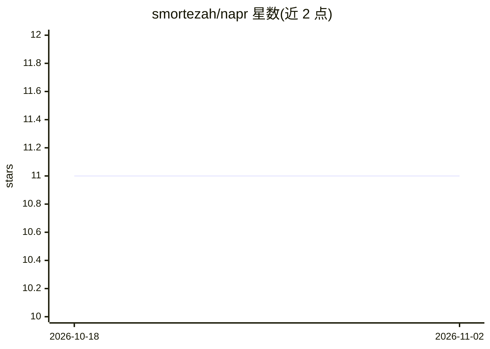

# smortezah/napr

⭐ 11 · Jupyter Notebook · MIT · 推送 2026-06-04 · [GitHub](https://github.com/smortezah/napr) · 个人维护

**用机器学习导航天然产物化学空间的 Python 库**

Napr 是一个 Python 库，面向天然产物化学空间的数据分析与机器学习：提供化学空间的探索性数据分析、聚类、可视化与分类等功能，附带基于 COCONUT 萜类数据集的教程 Notebook（探索分析与 kNN/随机森林/XGBoost 分类）。通过 pip 从 PyPI 安装，项目关联一篇发表于 Pharmaceuticals 2023 的论文。README 较简略，具体 API 与模块结构未展开。

## 筛选速览

| 维度 | 判定 | 备注 |
|---|---|---|
| AI 角色 | `ai-native` | 本体是模型或模型工具 |
| 许可风险 | `permissive` | MIT |
| 部署形态 | `library` | 以包/库形式分发 |
| 模型依赖 | — | README 未给出锁定关系 |
| 硬件要求 | — | 无带数字的原话,不猜 |
| 安装摩擦 | `low` | 无编译、无系统依赖或容器化 |
| 成熟度 | — | 结构信号不足 |

## 能力要点

- 天然产物化学空间的探索性分析与可视化
- 支持聚类与分类（教程含 kNN/随机森林/XGBoost）
- 附带 COCONUT 萜类数据集教程 Notebook

## 适用场景

- 对天然产物数据集做探索性分析与可视化
- 对萜类化合物做分类建模
- 化学空间聚类分析

## 场景标签

`数据分析` `教程课程` · 领域:效率与自动化

## 证据(README 行号)

> L10: **Navigate the natural products chemical space with Machine Learning.**
> L25: |Terpene-explore|Exploratory analysis of the COCONUT terpene dataset|
> L26: |Terpene-classification|Classification of terpenes with kNN, random forest & XGBoost methods|

## 星数曲线

2026-10-18 11 → 2026-11-02 11（+0）

---
*卡片 v1 · prompt 1.4 · 生成 2026-11-01 · 置信度 mid · 依据 README sha `1465a6987ce1` · [字段定义](../../DATASET.md)*
