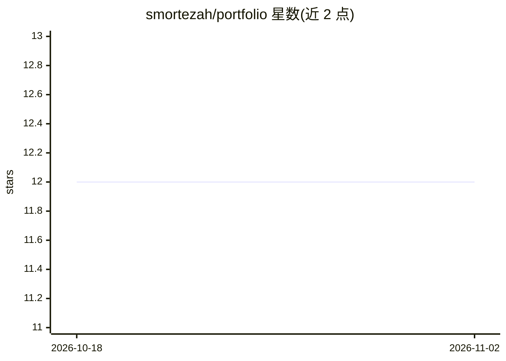

# smortezah/portfolio

⭐ 12 · Jupyter Notebook · 推送 2026-02-02 · [GitHub](https://github.com/smortezah/portfolio) · [官网](https://smortezah.github.io/portfolio/) · 个人维护

**个人 AI/数据科学/机器学习项目与教程集合**

个人作品集仓库，收录作者在 AI、数据科学与机器学习领域的探索性项目与教程，按主题分 20 余类组织，涵盖异常检测（信用卡欺诈）、图像分类、EDA、ETL 管道（Airflow+Docker）、超参调优（KerasTuner/Optuna）、时间序列预测（sktime）、数据匿名化、XAI 等条目，并包含大量 Python 语言与数据结构主题的教程式内容。文档链接与 Medium 文章作为延伸阅读，各条目为目录索引形式，不含统一安装入口。

## 筛选速览

| 维度 | 判定 | 备注 |
|---|---|---|
| AI 角色 | `ai-knowledge` | 知识聚合/清单类 |
| 许可风险 | `none` | — |
| 部署形态 | `None` |  |
| 模型依赖 | — | README 未给出锁定关系 |
| 硬件要求 | — | 无带数字的原话,不猜 |
| 安装摩擦 | `low` | 无编译、无系统依赖或容器化 |
| 成熟度 | — | 结构信号不足 |

## 能力要点

- 按字母组织的 20 余个主题分类项目索引
- 覆盖异常检测、图像分类、ETL、超参调优、时间序列等 AI/ML 主题
- 附 Python、数据结构、可视化等教程条目及 Medium 文章入口

## 适用场景

- 查找特定 AI/ML 主题的示例项目与实现参考
- 跟随教程学习数据处理、建模与 Python 技能
- 了解作者的技术能力与项目产出

## 场景标签

`教程课程` · 领域:学习与行业

## 证据(README 行号)

> L3: Welcome to my repository, a collection of my exploratory projects in the diverse fields of AI, Data Science and Mach
> L14: - Credit Card Fraud Detection: Unveil fraudulent transactions using a neural network-based approach.
> L22: - Ants vs Bees Image Classification: Harness the power of deep learning models to classify images.
> L116: ## :memo: XAI (Explainable AI)

## 星数曲线

2026-10-18 12 → 2026-11-02 12（+0）

---
*卡片 v1 · prompt 1.4 · 生成 2026-11-01 · 置信度 mid · 依据 README sha `1f271a5af3a1` · [字段定义](../../DATASET.md)*
