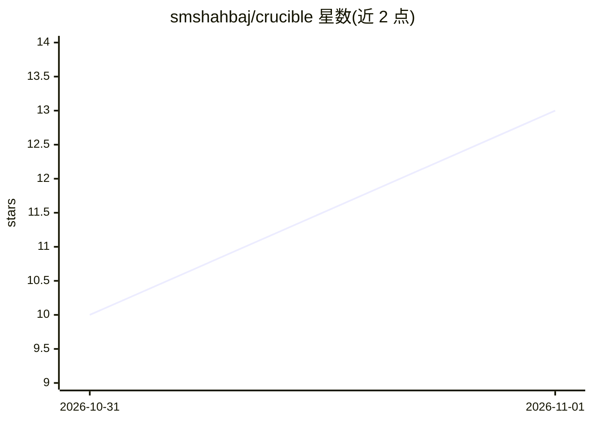

# smshahbaj/crucible

⭐ 13 · Python · MIT · 推送 2026-08-24 · [GitHub](https://github.com/smshahbaj/crucible) · [官网](https://crucible.smshahbaj.com) · 个人维护

**面向 Claude Code 等的决策压力测试技能插件**

以 Claude Code 插件/市场形式提供的自适应决策审查技能，同时兼容 OpenCode 与 Roo Code。按利害程度、可逆性、不确定性将决策路由到 QUICK/REVIEW/DEEP 三档审查深度，调度 14 个专职 agent 分别覆盖证据、选项、风险、失败模式、量化推理等视角；含证据门、反锚定、反事实压力测试与停止规则，可选本地 Decision Ledger 记录决策。正常使用需 Claude Code，无需数据库与单独模型 API key；Python 3.10+ 仅用于运行测试、基准与账本脚本。

## 筛选速览

| 维度 | 判定 | 备注 |
|---|---|---|
| AI 角色 | `ai-ecosystem` | LLM/agent 周边工具 |
| 许可风险 | `permissive` | MIT |
| 部署形态 | `library` | 以包/库形式分发 |
| 模型依赖 | locked-api |  |
| 硬件要求 | — | 无带数字的原话,不猜 |
| 安装摩擦 | `low` | 无编译、无系统依赖或容器化 |
| 成熟度 | — | 结构信号不足 |

## 能力要点

- 按利害/可逆性/不确定性路由到三档审查深度
- 14 个专职 agent 覆盖证据、风险、失败模式等视角
- 证据门、反锚定、反事实压力测试与停止规则
- 可选本地 Decision Ledger 与 120 用例基准测试

## 适用场景

- 在提交前压力测试架构选型或方案
- 对投资、签约等重大决策做多视角审查
- 在 Claude Code/OpenCode/Roo Code 中复查自己的决策理由

## 场景标签

 · 领域:开发工具/决策支持

## 证据(README 行号)

> L13: **Crucible is an adaptive decision-review skill for Claude Code, OpenCode, and Roo Code.**
> L57: This repository is both a **Claude Code plugin** (`.claude-plugin/plugin.json`) and a **Claude Code marketplace** (

## 星数曲线

2026-10-31 10 → 2026-11-01 13（+3）

---
*卡片 v1 · prompt 1.4 · 生成 2026-10-31 · 置信度 mid · 依据 README sha `a9ba4be5d5a0` · [字段定义](../../DATASET.md)*
