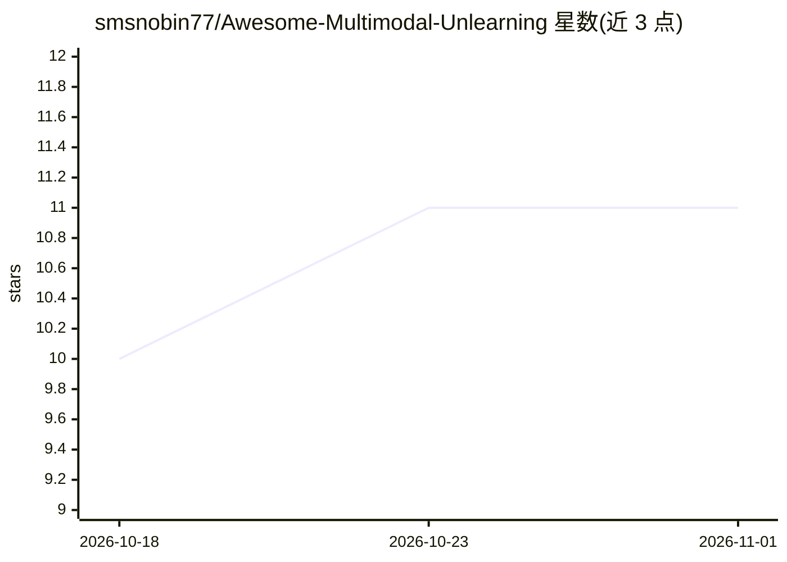

# smsnobin77/Awesome-Multimodal-Unlearning

⭐ 11 · Python · CC0-1.0 · 推送 2026-10-12 · [GitHub](https://github.com/smsnobin77/Awesome-Multimodal-Unlearning) · [官网](https://smsnobin77.github.io/Awesome-Multimodal-Unlearning/) · 组织维护

**多模态机器遗忘综述：跨视觉/语言/视频/音频的论文、数据集与基准清单**

由 University of Maryland, Baltimore County 等高校研究者维护的多模态遗忘（multimodal unlearning）综述仓库，配套论文被 ACL 2026 Findings 接收。按系统优先分类法将方法分为数据侧、训练时、架构约束、免训练、解码时五类干预阶段；收录 138 篇论文、13 项基准（统一套件/身份与隐私/内容与知识三类），并整理遗忘度、效用保持、鲁棒性、效率等评测维度与开放挑战，提供可检索筛选的交互式 Explorer。面向做模型遗忘、隐私合规与可信 AI 研究的科研人员。

## 筛选速览

| 维度 | 判定 | 备注 |
|---|---|---|
| AI 角色 | `ai-knowledge` | 知识聚合/清单类 |
| 许可风险 | `viral` | CC0-1.0 |
| 部署形态 | `None` |  |
| 模型依赖 | — | README 未给出锁定关系 |
| 硬件要求 | — | 无带数字的原话,不猜 |
| 安装摩擦 | `low` | 无编译、无系统依赖或容器化 |
| 成熟度 | — | 结构信号不足 |

## 能力要点

- 系统优先五阶段分类法（数据侧/训练时/架构约束/免训练/解码时）
- 收录 138 篇论文并按管线位置分组
- 13 项基准按统一套件、身份与隐私、内容与知识三类组织
- 提供可搜索、过滤、导出的交互式 Explorer

## 适用场景

- 查找多模态遗忘领域的方法论文与基准数据集
- 对比已有综述在模态覆盖与分类法上的差异
- 了解该领域开放挑战与评测指标维度

## 场景标签

`科研工具` `精选清单` · 领域:学习与行业

## 证据(README 行号)

> L1: Multimodal Unlearning Across Vision, Language, Video, and Audio: Survey of Methods, Datasets, and Benchmarks
> L123: We list **138 papers**, grouped by where they act in the model pipeline (Section 3 of the survey). Search, filter,

## 星数曲线

2026-10-18 10 → 2026-11-01 11（+1）

---
*卡片 v1 · prompt 1.4 · 生成 2026-11-01 · 置信度 high · 依据 README sha `eb458c568249` · [字段定义](../../DATASET.md)*
