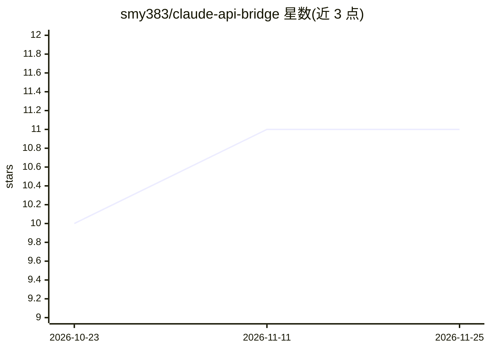

# smy383/claude-api-bridge

⭐ 11 · JavaScript · MIT · 推送 2026-03-23 · [GitHub](https://github.com/smy383/claude-api-bridge) · 个人维护

**把 Claude Code 订阅转为 REST API 供远程调用**

用 Node.js 将本机已认证的 Claude Code CLI 封装为 HTTP 服务：暴露 /api/ask 异步问答端点与令牌管理端点，经 Cloudflare Tunnel 自动生成公网 HTTPS 地址，支持无状态/有状态会话、SHA256 哈希令牌、速率限制、请求队列与崩溃恢复，数据存于本地 SQLite。前提是本机装有并认证 Claude Code CLI 且持有 Max 订阅；处理为串行，重启后免费隧道 URL 会变化。作者声明与 Anthropic 无隶属关系。

## 筛选速览

| 维度 | 判定 | 备注 |
|---|---|---|
| AI 角色 | `ai-ecosystem` | LLM/agent 周边工具 |
| 许可风险 | `permissive` | MIT |
| 部署形态 | `library` | 以包/库形式分发 |
| 模型依赖 | locked-api |  |
| 硬件要求 | — | 无带数字的原话,不猜 |
| 安装摩擦 | `low` | 无编译、无系统依赖或容器化 |
| 成熟度 | — | 结构信号不足 |

## 能力要点

- 一条 npx 命令启动，自动建立 Cloudflare Tunnel HTTPS 端点
- API 令牌 CRUD：创建/吊销/到期管理，仅存 SHA256 哈希
- 无状态/有状态（--resume 会话）两种调用模式
- 本地 SQLite 存储，无 Redis/Postgres 等外部数据库依赖

## 适用场景

- 让网页应用、脚本或聊天机器人远程调用本机的 Claude Code
- 在 CI 流水线中以 REST 方式触发 Claude Code 处理任务
- 为团队分发带过期时间的 API 令牌并经仪表盘监控用量

## 场景标签

`模型网关` · 领域:Agent 开发

## 证据(README 行号)

> L3:  Turn your Claude Code subscription into a REST API.
> L17: Existing open-source wrappers work great but are limited to `localhost`. **claude-api-bridge** adds **remote access
> L118: |`POST`|`/api/ask`|Token|Send a message to Claude Code|

## 星数曲线

2026-10-23 10 → 2026-11-25 11（+1）

---
*卡片 v1 · prompt 1.4 · 生成 2026-11-18 · 置信度 high · 依据 README sha `7cf5145452ad` · [字段定义](../../DATASET.md)*
