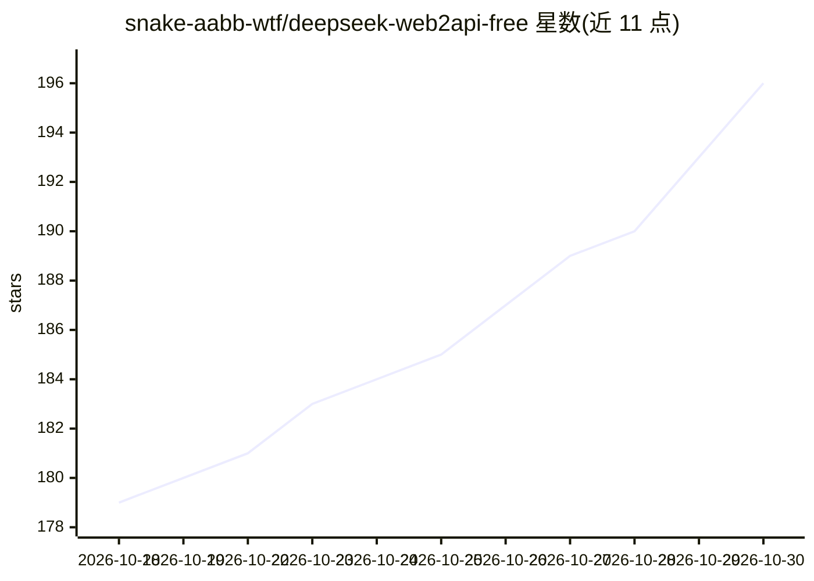

# snake-aabb-wtf/deepseek-web2api-free

⭐ 196 · Python · Unlicense · 推送 2026-10-28 · [GitHub](https://github.com/snake-aabb-wtf/deepseek-web2api-free) · 个人维护 · 中文 README

**将 DeepSeek 网页版转换为 OpenAI/Anthropic 兼容 API 的代理**

基于 FastAPI 的非官方代理：从浏览器提取 DeepSeek Chat 凭证（Token+Cookies），自动完成 WASM PoW 鉴权挑战，将网页版私有 API 封装为 /v1/chat/completions（OpenAI 兼容）与 /v1/messages（Anthropic 兼容）端点，支持流式输出、thinking_mode 深度思考（reasoning_content）、联网搜索及基于 DSML 提示词注入的工具调用。面向希望在无官方 API Key 情况下用 DeepSeek 的开发者。提供多账号池轮询、滑动窗口限流、tiktoken 用量估算与 React WebUI 管理面板。README 声明仅限学习研究、不保证稳定性；上游已合并快速/专家模式，MODE 环境变量已废弃。

## 筛选速览

| 维度 | 判定 | 备注 |
|---|---|---|
| AI 角色 | `ai-ecosystem` | LLM/agent 周边工具 |
| 许可风险 | `permissive` | Unlicense |
| 部署形态 | `desktop` | 安装包/桌面程序 |
| 模型依赖 | locked-api |  |
| 硬件要求 | — | 无带数字的原话,不猜 |
| 安装摩擦 | `low` | 无编译、无系统依赖或容器化 |
| 成熟度 | — | 结构信号不足 |

## 能力要点

- 自动求解 DeepSeekHashV1 PoW 鉴权挑战，无需官方 API Key
- OpenAI /v1/chat/completions 与 Anthropic /v1/messages 双兼容端点，支持流式
- DSML 提示词注入实现 Function Calling，StreamSieve 从 SSE 流分离工具调用
- 多账号池轮询 + 滑动窗口限流 + WebUI 管理面板

## 适用场景

- 用现有 OpenAI/Anthropic 客户端直接调用 DeepSeek Chat
- 在 NextChat、Open WebUI 等客户端中使用 DeepSeek 并展示思维链
- 通过账号池多账号轮询搭建自用代理服务

## 场景标签

`模型网关` · 领域:Agent 开发

## 证据(README 行号)

> L3: > 将 DeepSeek Chat (chat.deepseek.com) 的私有 API 转换为 OpenAI / Anthropic 兼容格式。
> L11: - **OpenAI 兼容** — `/v1/chat/completions` 与 `/v1/models` 接口，支持 `stream` 模式
> L18: - **Function Calling** — 基于 DSML（DeepSeek Markup Language）提示词注入实现工具调用

## 星数曲线

2026-10-18 179 → 2026-10-30 196（+17）

---
*卡片 v1 · prompt 1.4 · 生成 2026-10-22 · 置信度 mid · 依据 README sha `f19dbe4be5cc` · [字段定义](../../DATASET.md)*
