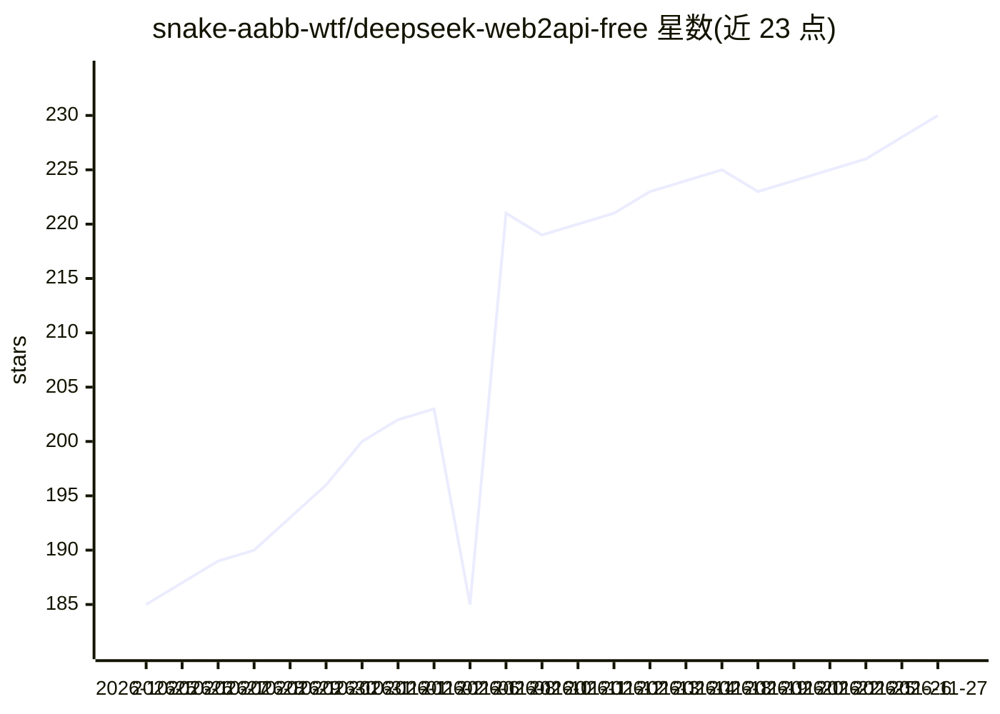

# snake-aabb-wtf/deepseek-web2api-free

⭐ 230 · Python · Unlicense · 推送 2026-11-23 · [GitHub](https://github.com/snake-aabb-wtf/deepseek-web2api-free) · 个人维护 · 中文 README

**把 DeepSeek 网页版转为 OpenAI/Anthropic 兼容 API 的反向代理**

基于 FastAPI 的自部署服务，将 chat.deepseek.com 的网页私有 API 封装为 OpenAI `/v1/chat/completions`、Anthropic `/v1/messages` 与 Responses 接口。需从浏览器提取账号 Token 与 Cookies 加入账号池，服务端自动完成 PoW 鉴权挑战与会话管理，提供多账号轮询、滑动窗口限流、Web 管理面板与 Playground。思维链经 reasoning_content 输出，工具调用靠 DSML 提示词注入实现。README 注明仅限学习研究，稳定性不做保证，temperature/max_tokens 等参数被忽略。

## 筛选速览

| 维度 | 判定 | 备注 |
|---|---|---|
| AI 角色 | `ai-ecosystem` | LLM/agent 周边工具 |
| 许可风险 | `permissive` | Unlicense |
| 部署形态 | `desktop` | 安装包/桌面程序 |
| 模型依赖 | locked-api |  |
| 硬件要求 | — | 无带数字的原话,不猜 |
| 安装摩擦 | `low` | 无编译、无系统依赖或容器化 |
| 成熟度 | `idea` | |

## 能力要点

- OpenAI 与 Anthropic 双格式兼容端点，支持流式 SSE
- 自动完成 WASM PoW（DeepSeekHashV1）挑战，无需官方 API Key
- 多账号池轮询、健康检查与加密存储（Fernet）
- DSML 提示词注入实现 Function Calling，StreamSieve 实时分离工具调用

## 适用场景

- 让已用 OpenAI SDK 的脚本接入 DeepSeek 网页账号
- 在 NextChat、Open WebUI 等客户端中展示思维链
- 搭建带限流与用量统计的公网代理端点
- 用 Playground 在线测试思考模式与联网搜索

## 场景标签

`模型网关` · 领域:Agent 开发

## 证据(README 行号)

> L5: > 将 DeepSeek Chat (chat.deepseek.com) 的私有 API 转换为 OpenAI / Anthropic 兼容格式。
> L13: - **OpenAI 兼容** — `/v1/chat/completions` 与 `/v1/models` 接口，支持 `stream` 模式
> L29: - **管理面板** — 内置 Web 管理界面，支持请求统计、账号池管理（多账号轮询/持久化增删改查/重登录）

## 星数曲线

2026-10-25 185 → 2026-11-27 230（+45）

---
*卡片 v1 · prompt 1.4 · 生成 2026-11-25 · 置信度 mid · 依据 README sha `c9b10d8da26e` · [字段定义](../../DATASET.md)*
