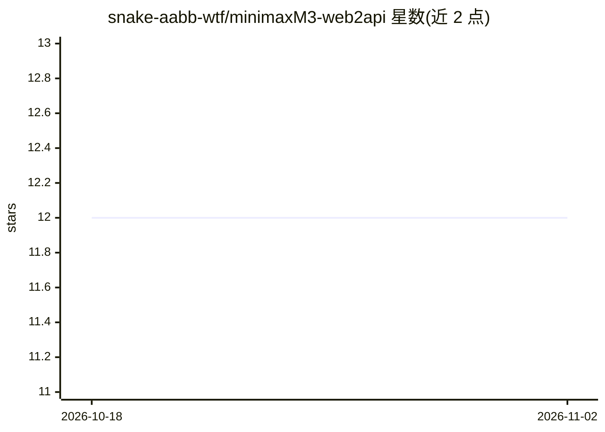

# snake-aabb-wtf/minimaxM3-web2api

⭐ 12 · Python · GPL-3.0 · 推送 2026-06-03 · [GitHub](https://github.com/snake-aabb-wtf/minimaxM3-web2api) · 个人维护 · 中文 README

**将 MiniMax Agent 网页聊天逆向为 OpenAI 兼容 API 的代理**

面向开发者的 FastAPI 代理服务：通过逆向 MiniMax Agent 网页前端 JS 签名算法（x-signature 与 yy，均基于 MD5），将网页聊天接口转为 OpenAI 兼容的 /v1/chat/completions API，支持 SSE 流式与非流式响应，并通过 DSML 注入实现 function calling。用户需从浏览器导出 HAR 文件，由 config_tool.py 提取 JWT Token 与浏览器参数生成 .env；sign.py 为纯函数库无需配置。Token 过期后需重新捕获 HAR 更新。以 GPL-3.0 发布。

## 筛选速览

| 维度 | 判定 | 备注 |
|---|---|---|
| AI 角色 | `ai-ecosystem` | LLM/agent 周边工具 |
| 许可风险 | `viral` | GPL-3.0 |
| 部署形态 | `None` |  |
| 模型依赖 | — | README 未给出锁定关系 |
| 硬件要求 | — | 无带数字的原话,不猜 |
| 安装摩擦 | `low` | 无编译、无系统依赖或容器化 |
| 成熟度 | — | 结构信号不足 |

## 能力要点

- 逆向实现 x-signature/yy 签名算法，任意消息实时签名，非 HAR 重放
- OpenAI 兼容 /v1/chat/completions，支持 SSE 流式与非流式
- 通过 DSML 注入实现 OpenAI 格式 function calling
- HAR 解析工具自动提取 Token 与浏览器参数生成 .env

## 适用场景

- 把 MiniMax Agent 网页端接入支持 OpenAI API 的应用或客户端
- 在自有应用中调用 MiniMax-M3 的流式对话与工具调用
- 为已有 OpenAI 兼容工作流增加 MiniMax 通道

## 场景标签

`模型网关` · 领域:Agent 开发

## 证据(README 行号)

> L18: 本项目通过逆向 MiniMax Agent（`agent.minimaxi.com`）网页前端的 **JavaScript 签名算法**，将网页聊天接口转化为完全 **OpenAI 兼容** 的 REST API 代理。
> L202: ### `POST /v1/chat/completions`
> L204: OpenAI 完全兼容。

## 星数曲线

2026-10-18 12 → 2026-11-02 12（+0）

---
*卡片 v1 · prompt 1.4 · 生成 2026-11-01 · 置信度 high · 依据 README sha `b71ea3f9a379` · [字段定义](../../DATASET.md)*
