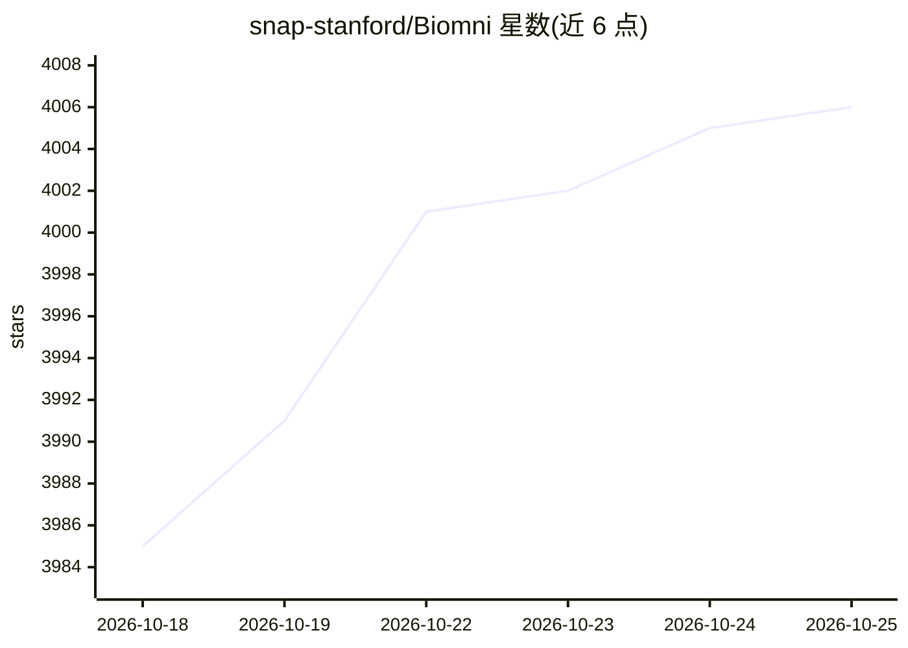

# snap-stanford/Biomni

⭐ 4,009 · Python · Apache-2.0 · 推送 2026-10-19 · [GitHub](https://github.com/snap-stanford/Biomni) · [官网](https://biomni.stanford.edu) · 组织维护

**斯坦福的生物医学 AI agent，自主执行科研任务**

通用型生物医学 AI agent：以 LLM 推理结合检索增强规划与代码执行，自主完成跨子领域的研究任务并生成可检验假设。首次创建 agent 时自动下载约 11GB 的 datalake；支持 MCP 外部工具接入、Gradio 网页界面、PDF 报告生成与集中配置管理。配套 Biomni-R0 推理模型（基于 Qwen-32B、SGLang 本地部署）与 Eval1 评测基准（433 实例、10 类任务）。需注意：agent 以完整系统权限执行 LLM 生成代码，README 建议在隔离/沙箱环境使用。

## 筛选速览

| 维度 | 判定 | 备注 |
|---|---|---|
| AI 角色 | `ai-native` | 本体是模型或模型工具 |
| 许可风险 | `permissive` | Apache-2.0 |
| 部署形态 | `library` | 以包/库形式分发 |
| 模型依赖 | locked-api |  |
| 硬件要求 | — | 无带数字的原话,不猜 |
| 安装摩擦 | `low` | 无编译、无系统依赖或容器化 |
| 成熟度 | — | 结构信号不足 |

## 能力要点

- LLM 推理 + 检索增强规划 + 代码执行自主完成任务
- MCP 服务器支持外部工具集成
- 配套 Biomni-R0 推理模型与 Eval1 评测基准（433 实例/10 任务）
- Know-How Library 按查询相关性自动检索领域知识

## 适用场景

- 让 agent 自主执行生物医学研究任务并生成假设
- 通过网页或 Gradio 界面无代码使用
- 用 Eval1 评估生物推理能力

## 场景标签

`科研工具` `模型评测` · 领域:评测与运维

## 证据(README 行号)

> L23: Biomni is a general-purpose biomedical AI agent designed to autonomously execute a wide range of research tasks acr
> L308: - Security warning: Currently, Biomni executes LLM-generated code with full system privileges. If you want to use 

## 星数曲线

2026-10-18 3,985 → 2026-10-25 4,006（+21）

---
*卡片 v1 · prompt 1.4 · 生成 2026-10-20 · 置信度 high · 依据 README sha `d50cf86f5cf2` · [字段定义](../../DATASET.md)*
